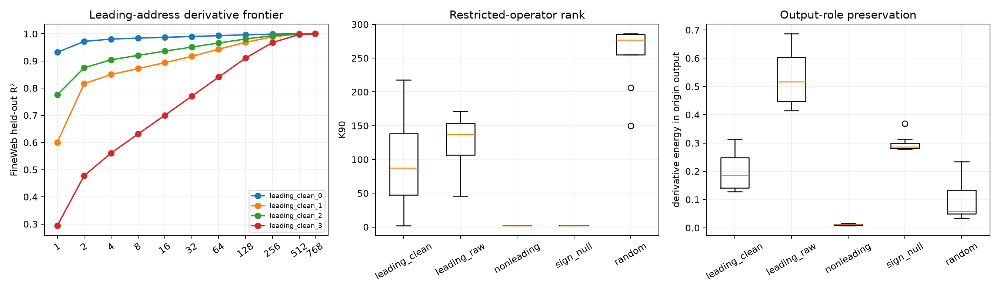

# Independent Layer-5 weight-conditioned spectral addresses

The leading output direction is selected from the complete bilinear weight tensor. Contracting that output direction into the tensor gives an exact symmetric input form. The top covariance-cleaned eigenvectors of that form define four input addresses without labels or clustering. Contracting each address into the native tensor gives an exact `context → write` derivative operator, whose frozen natural-metric SVD is evaluated on FineWeb, WikiText, and TinyStories. Raw-form, nonleading-output, sign-scrambled-channel, and random natural-direction controls are matched in the same pipeline.

## Locked hypotheses

- **A1_restricted_derivative_identity_is_exact: supported.**
- **A2_leading_addresses_are_rank64_compact: supported.**
- **A3_leading_addresses_beat_random_compactness: supported.**
- **A4_leading_addresses_have_clean_output_role: not supported.**
- **A5_output_role_beats_sign_nulls: not supported.**
- **A6_rank64_compactness_transfers_ood: supported.**
- **A7_covariance_cleaning_shortens_addresses: supported.**
- **A8_cleaned_address_subspace_is_split_stable: supported.**
- **A9_leading_mode_is_more_compact_than_nonleading_modes: not supported.**

Even/odd cleaned-address mean canonical cosine: **0.986** in native edit space and **0.990** in whitened coordinates.

| Address | K90 | Effective rank | Leading-output energy | Rank-64 R² FineWeb / WikiText / TinyStories |
|---|---:|---:|---:|---:|
| leading_clean_0 | 2 | 1.3 | 0.313 | 0.993 / 0.992 / 0.993 |
| leading_clean_1 | 112 | 3.8 | 0.226 | 0.943 / 0.948 / 0.936 |
| leading_clean_2 | 63 | 2.3 | 0.129 | 0.966 / 0.963 / 0.968 |
| leading_clean_3 | 218 | 17.2 | 0.144 | 0.841 / 0.843 / 0.831 |
| leading_raw_0 | 148 | 3.7 | 0.458 | 0.896 / 0.907 / 0.856 |
| leading_raw_1 | 46 | 1.5 | 0.687 | 0.972 / 0.968 / 0.968 |
| leading_raw_2 | 127 | 2.5 | 0.576 | 0.933 / 0.940 / 0.932 |
| leading_raw_3 | 171 | 4.9 | 0.415 | 0.882 / 0.905 / 0.839 |
| nonleading_mode1 | 2 | 1.4 | 0.015 | 0.991 / 0.990 / 0.991 |
| nonleading_mode2 | 2 | 1.4 | 0.007 | 0.991 / 0.989 / 0.991 |
| nonleading_mode3 | 2 | 1.3 | 0.011 | 0.993 / 0.992 / 0.993 |

| Group | Count | Median K90 | Median leading-output energy |
|---|---:|---:|---:|
| leading_clean | 4 | 87.5 | 0.185 |
| leading_raw | 4 | 137.5 | 0.517 |
| nonleading | 3 | 2.0 | 0.011 |
| sign_null | 8 | 2.0 | 0.286 |
| random | 8 | 277.0 | 0.058 |

An address is an input direction that strongly changes one selected output score. It is not itself a complete semantic feature. Compact restricted rank would mean the address invokes a short reusable context-conditioned operation; high output-role energy would mean that operation mostly preserves the output question used to discover it. Sign and random controls test whether either property is specific to the apparent spectral spike.
