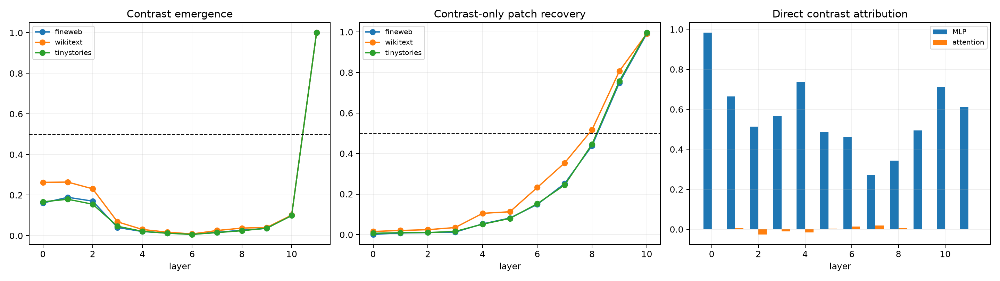

# Layerwise emergence and causal tracing of boundary contrasts

For actual final-token-to-newline edits, this audit tracks the final Layer-11 address PC3–PC4 coordinates through every normalized pre-MLP state. At each block, the exact output-residual contrast is allocated among mixed residual/embedding input, attention, and MLP write. A stronger intervention patches only the two contrast coordinates of each changed layer output into the original run, keeps the original attention value bus, and measures recovery of the final Layer-11 contrast and full changed logits.

## Locked hypotheses

- **E1_boundary_contrast_emerges_before_layer9: not supported.**
- **E2_early_contrast_patch_is_causally_effective: not supported.**
- **E3_layer10_contrast_patch_is_nearly_sufficient: supported.**
- **E4_contrast_only_patch_is_not_full_logit_sufficient: supported.**
- **E5_middle_mlp_writes_create_the_largest_contrast_increment: not supported.**
- **E6_attention_never_dominates_direct_contrast_writing: supported.**
- **E7_emergence_depth_transfers_ood: supported.**
- **E8_late_residual_patch_recovery_is_monotone: supported.**

| Corpus | First ≥50% energy | Best early patch | Layer-10 recovery | Best patch layer | Best relative full KL | Largest MLP layer |
|---|---:|---:|---:|---:|---:|---:|
| fineweb | 11 | 0.438 | 0.992 | 10 | 0.606 | 0 |
| wikitext | 11 | 0.517 | 0.992 | 10 | 0.921 | 0 |
| tinystories | 11 | 0.446 | 0.996 | 10 | 0.658 | 0 |

Descriptive emergence and causal patch recovery answer different questions. A direction can be visible early yet not survive downstream processing when patched alone. Keeping the original value bus makes this specifically a residual-route test; it does not claim that attention's separate value-memory route is absent.
