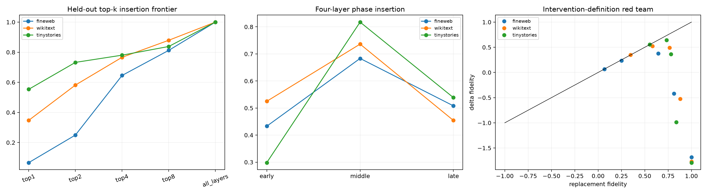

# Multilayer attention-routing audit

Layer rankings were frozen from the source-distance panel and evaluated on fresh corpus rows. In replacement interventions, selected base-run attention writes are replaced by native changed-run writes (or vice versa for removal). In additive-delta interventions, the native hybrid write is adjusted by the fixed changed-minus-base write. MLPs and all unselected attention layers recompute normally.

## Locked hypotheses

- **M1_all_attention_replacement_removal_blocks_the_path: supported.**
- **M2_all_attention_insertion_recovers_most_of_the_effect: supported.**
- **M3_top4_captures_most_available_insertion: not supported.**
- **M4_routing_is_distributed_beyond_one_layer: supported.**
- **M5_middle_layers_are_the_main_phase: not supported.**
- **M6_replacement_and_delta_interventions_agree: not supported.**
- **M7_topk_frontier_is_monotone: not supported.**
- **M8_all_attention_is_structurally_necessary_but_not_a_single_module: not supported.**

| Corpus | Position | Full KL | Top1 / top4 / all replacement fidelity | Early / middle / late fidelity | All-removal projection | All-removal base error |
|---|---:|---:|---:|---:|---:|---:|
| fineweb | 63 | 0.0042 | 0.124 / 0.458 / 1.000 | 0.128 / 0.353 / 0.587 | 0.0000 | 0.00e+00 |
| fineweb | 95 | 0.0110 | -0.007 / 0.636 / 1.000 | 0.551 / 0.854 / 0.434 | 0.0000 | 0.00e+00 |
| fineweb | 119 | 0.1142 | 0.083 / 0.843 / 1.000 | 0.621 / 0.843 / 0.503 | 0.0000 | 0.00e+00 |
| wikitext | 63 | 0.0166 | 0.393 / 0.845 / 1.000 | 0.459 / 0.797 / 0.437 | 0.0000 | 0.00e+00 |
| wikitext | 95 | 0.0143 | 0.302 / 0.746 / 1.000 | 0.515 / 0.672 / 0.479 | 0.0000 | 0.00e+00 |
| wikitext | 119 | 0.0715 | 0.348 / 0.708 / 1.000 | 0.601 / 0.740 / 0.446 | 0.0000 | 0.00e+00 |
| tinystories | 63 | 0.0063 | 0.645 / 0.911 / 1.000 | -0.009 / 0.882 / 0.512 | 0.0000 | 0.00e+00 |
| tinystories | 95 | 0.0071 | 0.485 / 0.748 / 1.000 | 0.524 / 0.791 / 0.569 | 0.0000 | 0.00e+00 |
| tinystories | 119 | 0.0584 | 0.531 / 0.682 / 1.000 | 0.379 / 0.780 / 0.535 | 0.0000 | 0.00e+00 |

All-attention removal is a structural path test; all-attention insertion is a sufficiency test. The first can pass while the second fails because changed attention writes were computed jointly with changed source-position residuals, embeddings, and value memory. Top-k curves test compression of the route, not whether the selected layers uniquely own the information.
