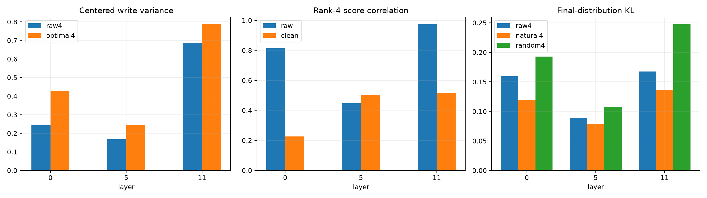

# Natural-state and causal validation of independent-checkpoint outliers

Raw full-tensor output directions from the 12-layer checkpoint are compared with centered FineWeb MLP writes, covariance-cleaned input forms, and exact final-distribution effects when only the final-position MLP write is retained in a frozen subspace. Discovery, evaluation, and behavioral rows are disjoint. Causal projections use the post-bias write mean; an earlier pre-bias centering bug was corrected before these reported values.

## Locked hypotheses

- **N1_raw_top4_tracks_natural_write: supported.**
- **N2_middle_leading_spike_is_used: supported.**
- **N3_late_raw4_is_behaviorally_compact: not supported.**
- **N4_raw4_beats_random_behaviorally: supported.**
- **N5_covariance_cleaning_shortens_forms: not supported.**
- **N6_cleaned_forms_predict_heldout_scores: not supported.**
- **N7_full_projection_identity: supported.**

| Layer | Raw/optimal variance@4 | Efficiency | Raw-natural overlap | Raw/clean score corr. | Clean form top-4 | KL raw4 / natural4 / random4 |
|---:|---:|---:|---:|---:|---:|---:|
| 0 | 0.244 / 0.430 | 0.567 | 0.342 | 0.814 / 0.225 | 0.920 | 0.1597 / 0.1191 / 0.1928 |
| 5 | 0.168 / 0.245 | 0.684 | 0.409 | 0.448 / 0.504 | 0.837 | 0.0892 / 0.0784 / 0.1074 |
| 11 | 0.687 / 0.786 | 0.874 | 0.663 | 0.973 / 0.518 | 0.994 | 0.1676 / 0.1360 / 0.2472 |

Raw spectral energy, natural-use variance, covariance-short score prediction, and final-distribution sufficiency are distinct validation levels. A spike can pass the first and fail any of the latter three.

**Cleaning caveat.** The covariance-cleaning rows here used only 1,024 discovery states. The later [sample-size and ridge stability red team](BILIN12_CLEANING_STABILITY_REDTEAM.md) supersedes N5/N6 as evidence about cleaning: at this width, cleaning is a regularized covariance-estimation problem, and the small-sample result is not stable enough to support a fourth-moment interpretation.
