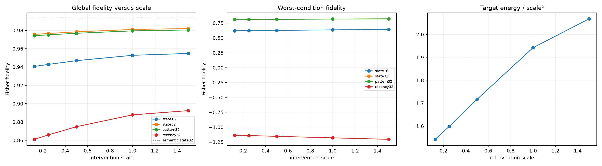

# Newline source-program scale red team

Fresh newline counterfactuals keep the exact source-edge ranking fixed while both the full final-destination message and each truncated approximation are scaled from 0.125x to 1.5x before suffix recomputation. This separates source geometry from finite-effect nonlinearity and compares the small-scale limit with the semantic-edit transfer result.

## Locked hypotheses

- **A1_small_newline_edits_match_semantic_state32_fidelity: supported.**
- **A2_state32_fidelity_improves_as_scale_shrinks: not supported.**
- **A3_small_scale_repairs_the_worst_conditions: not supported.**
- **A4_pattern32_improves_as_scale_shrinks: not supported.**
- **A5_fisher_target_energy_is_locally_quadratic: supported.**
- **A6_state_rule_still_beats_recency_at_small_scale: not supported.**
- **A7_state16_remains_less_robust_than_state32: supported.**
- **A8_large_scale_exposes_nonlinear_metric_failure: supported.**
- **A9_scale_does_not_fully_explain_semantic_transfer: not supported.**
- **A10_source_geometry_and_effect_scale_both_matter: not supported.**

| Scale | State16 | State32 | Pattern32 | Recency32 | State32 minimum |
|---:|---:|---:|---:|---:|---:|
| 0.125 | 0.941 | 0.976 | 0.974 | 0.861 | 0.811 |
| 0.250 | 0.943 | 0.977 | 0.975 | 0.866 | 0.812 |
| 0.500 | 0.947 | 0.978 | 0.977 | 0.875 | 0.814 |
| 1.000 | 0.953 | 0.981 | 0.979 | 0.888 | 0.817 |
| 1.500 | 0.955 | 0.982 | 0.980 | 0.892 | 0.820 |

Semantic state-norm top-32 reference: **0.993**. Small-scale newline state32: **0.976**. Gap: **0.017**. Local quadratic-energy coefficient of variation: **0.045**.
