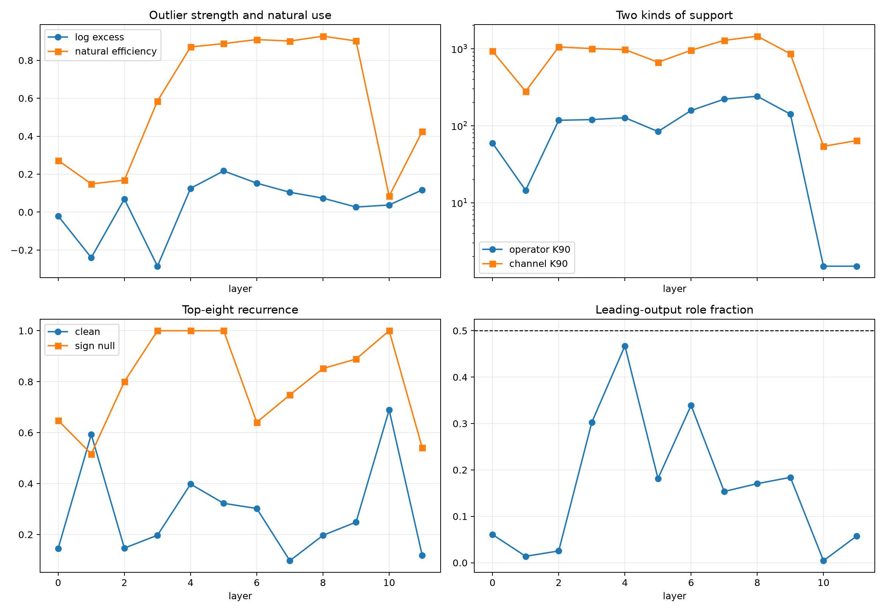

# Outlier-to-circuit depth sweep in the independent 12-layer model

At every layer, the raw tensor's leading output mode is converted into four covariance-cleaned input addresses. Their exact restricted derivative operators are measured both in singular coordinates and as sums of native rank-one MLP channels. Four channel-sign nulls preserve all channel magnitudes but destroy coordinated signs.

## Locked hypotheses

- **D1_powerlaw_bulk_holds_at_all_layers: supported.**
- **D2_outlier_excess_predicts_natural_use: not supported.**
- **D3_outlier_excess_predicts_operator_compactness: not supported.**
- **D4_strongest_outliers_are_small_native_circuits: not supported.**
- **D5_compact_operator_broad_channel_mismatch_is_common: not supported.**
- **D6_clean_address_recurrence_beats_sign_nulls: not supported.**
- **D7_clean_addresses_are_more_distributed_than_sign_nulls: not supported.**
- **D8_strong_outliers_are_output_pure: not supported.**

Cross-layer correlations: `{'excess_vs_natural_efficiency_spearman': 0.46153846153846156, 'excess_vs_operator_k90_spearman': 0.2447552447552448, 'excess_vs_channel_k90_spearman': 0.04195804195804196, 'natural_efficiency_vs_channel_k90_spearman': 0.5314685314685316}`. Strongest leading-excess layers: `[5, 6, 4]`.

| Layer | Lead excess | Natural eff. | Operator K90 | Channel K90 | Clean/null recurrence | Output role |
|---:|---:|---:|---:|---:|---:|---:|
| 0 | -0.020 | 0.272 | 59.5 | 928.0 | 0.146/0.648 | 0.061 |
| 1 | -0.240 | 0.149 | 14.5 | 278.5 | 0.593/0.516 | 0.014 |
| 2 | 0.069 | 0.168 | 117.5 | 1052.0 | 0.147/0.800 | 0.025 |
| 3 | -0.285 | 0.585 | 120.0 | 1002.5 | 0.197/1.000 | 0.303 |
| 4 | 0.125 | 0.870 | 127.0 | 971.5 | 0.398/1.000 | 0.467 |
| 5 | 0.217 | 0.888 | 84.0 | 667.0 | 0.322/1.000 | 0.181 |
| 6 | 0.152 | 0.909 | 157.5 | 952.5 | 0.302/0.640 | 0.339 |
| 7 | 0.104 | 0.901 | 221.0 | 1281.5 | 0.097/0.748 | 0.154 |
| 8 | 0.073 | 0.927 | 241.0 | 1450.5 | 0.197/0.852 | 0.170 |
| 9 | 0.027 | 0.902 | 141.0 | 858.0 | 0.249/0.889 | 0.184 |
| 10 | 0.037 | 0.084 | 1.5 | 54.0 | 0.689/1.000 | 0.004 |
| 11 | 0.117 | 0.425 | 1.5 | 64.0 | 0.118/0.541 | 0.057 |

A raw spectral outlier, a naturally used output direction, a compact restricted operator, a localized native-neuron implementation, recurrent channels, and a pure output role are deliberately scored separately. Correlation can prioritize a search; it cannot collapse these definitions into one notion of a clean circuit.
