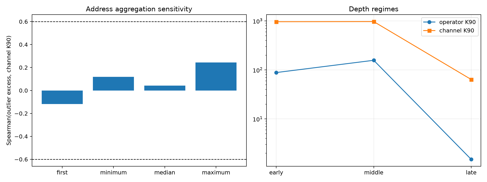

# Metric-sensitivity red team for the outlier depth sweep

This post-sweep red team asks whether the negative result was an artifact of using the median of four cleaned addresses and whether the apparent late compactness simply follows outlier strength.

## Locked hypotheses

- **R1_no_address_aggregation_recovers_strong_outlier_localization: supported.**
- **R2_strong_outliers_have_a_small_first_address: not supported.**
- **R3_outlier_natural_use_relation_is_weak_leave_one_out: supported.**
- **R4_sign_null_top_channel_recurrence_is_structural: supported.**
- **R5_late_layers_form_a_compact_program_phase: supported.**
- **R6_late_compactness_is_not_explained_by_stronger_outliers: supported.**

Address-aggregation correlations: `{'first': -0.1188811188811189, 'minimum': 0.1188811188811189, 'median': 0.04195804195804196, 'maximum': 0.2447552447552448}`.
Leave-one-layer-out excess/use correlations span `0.373` to `0.591`.
Sign-null top channel is unanimous in layers `[1, 2, 3, 5, 6, 7, 8, 10]`.

| Phase | Median excess | Natural efficiency | Operator K90 | Channel K90 |
|---|---:|---:|---:|---:|
| early | -0.130 | 0.220 | 88.5 | 965.2 |
| middle | 0.125 | 0.901 | 157.5 | 971.5 |
| late | 0.037 | 0.425 | 1.5 | 64.0 |

The late compact-program phase is real in this checkpoint, but it is not an outlier-strength phase: middle layers have stronger outliers and broader programs. Sign-null unanimity confirms that recurrent native channels can arise from structurally dominant coordinate magnitudes even after coordinated signs are destroyed.
