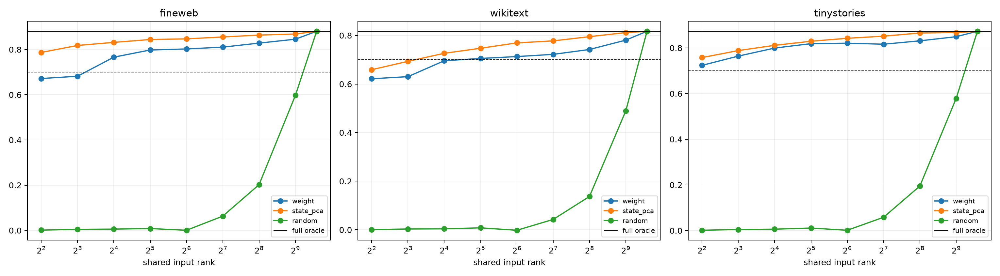

# Canonical quadratic router into the pooled write backbone

The native Layer-11 bilinear weights and the frozen pooled rank-32 output basis define 32 exact symmetric quadratic forms. Their joint squared operator fixes a shared weight-canonical input basis. Truncating that basis tests whether the exact router has a compact, basis-invariant input description; FineWeb state PCA and Haar-random spaces are matched-rank controls.

## Locked hypotheses

- **Q0_exact_tensor_map_recomposes_coefficients: supported.**
- **Q1_weight_rank64_is_sufficient: supported.**
- **Q2_weight_rank128_is_sufficient: supported.**
- **Q3_weight_subspace_beats_random: supported.**
- **Q4_weight_subspace_beats_state_pca: not supported.**
- **Q5_one_compact_input_space_transfers_ood: supported.**
- **Q6_quadratic_map_repairs_linear_wikitext_failure: supported.**

| Corpus | Full oracle | Weight rank 32/64/128/256 | State-PCA rank 64 | Random rank 64 | Minimum passing weight rank |
|---|---:|---:|---:|---:|---:|
| fineweb | 0.881 | 0.798/0.802/0.810/0.828 | 0.847 | 0.001 | 16 |
| wikitext | 0.817 | 0.705/0.713/0.722/0.742 | 0.769 | -0.002 | 32 |
| tinystories | 0.873 | 0.819/0.821/0.816/0.831 | 0.842 | 0.001 | 4 |

The full quadratic map is an exact mechanistic explanation of this final-layer interface, not a learned probe. Truncation asks the separate description-length question. A high required rank would mean the computation is understood algebraically but is not small in this particular shared-input ontology.
