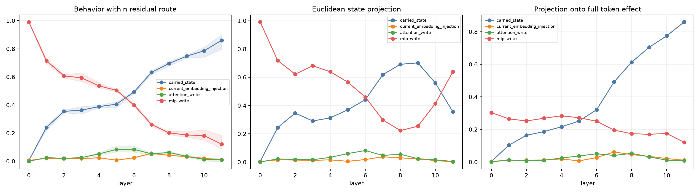

# Residual-carrier component audit across depth

For a final-token-to-newline edit, each block output change is exactly split into four additive vectors: carried prior residual, the block's fresh original-embedding injection, attention write, and bilinear-MLP write. All 16 combinations are propagated through the suffix with the base embedding stream and base value bus. Vector Shapley therefore allocates the changed-residual-only behavioral effect, while a separate projection shows alignment with the complete token-edit effect.

## Locked hypotheses

- **D1_exact_component_recomposition: not supported.**
- **D2_some_attention_write_is_behaviorally_material: not supported.**
- **D3_some_mlp_write_is_behaviorally_material: supported.**
- **D4_current_embedding_injection_is_locally_material: not supported.**
- **D5_late_residual_is_not_just_carried_state: supported.**
- **D6_component_depth_order_transfers_ood: supported.**
- **D7_state_energy_is_not_behavioral_credit: supported.**
- **D8_attention_is_not_the_dominant_noncarried_source: supported.**

| Corpus | Layer | Carried / inject / attention / MLP behavioral Shapley | State projection | Full-target sum |
|---|---:|---:|---:|---:|
| fineweb | 0 | 0.005 / 0.005 / -0.000 / 0.991 | 0.004 / 0.004 / 0.000 / 0.992 | 0.333 |
| fineweb | 1 | 0.222 / 0.018 / 0.027 / 0.733 | 0.248 / 0.016 / 0.025 / 0.712 | 0.414 |
| fineweb | 2 | 0.354 / 0.017 / 0.018 / 0.610 | 0.350 / 0.014 / 0.020 / 0.617 | 0.453 |
| fineweb | 3 | 0.389 / 0.017 / 0.027 / 0.566 | 0.296 / 0.013 / 0.017 / 0.674 | 0.494 |
| fineweb | 4 | 0.381 / 0.023 / 0.039 / 0.557 | 0.314 / 0.017 / 0.041 / 0.628 | 0.560 |
| fineweb | 5 | 0.414 / 0.007 / 0.067 / 0.512 | 0.363 / 0.005 / 0.056 / 0.576 | 0.584 |
| fineweb | 6 | 0.500 / 0.026 / 0.081 / 0.394 | 0.442 / 0.018 / 0.077 / 0.462 | 0.666 |
| fineweb | 7 | 0.635 / 0.058 / 0.043 / 0.264 | 0.614 / 0.038 / 0.044 / 0.304 | 0.807 |
| fineweb | 8 | 0.678 / 0.040 / 0.069 / 0.213 | 0.680 / 0.031 / 0.056 / 0.234 | 0.907 |
| fineweb | 9 | 0.733 / 0.028 / 0.029 / 0.211 | 0.678 / 0.021 / 0.025 / 0.276 | 0.954 |
| fineweb | 10 | 0.740 / 0.014 / 0.023 / 0.223 | 0.540 / 0.010 / 0.013 / 0.437 | 0.988 |
| fineweb | 11 | 0.795 / 0.007 / 0.014 / 0.184 | 0.344 / 0.001 / 0.004 / 0.651 | 1.000 |
| wikitext | 0 | 0.005 / 0.005 / 0.000 / 0.990 | 0.004 / 0.004 / 0.001 / 0.991 | 0.334 |
| wikitext | 1 | 0.240 / 0.021 / 0.022 / 0.717 | 0.234 / 0.014 / 0.021 / 0.731 | 0.408 |
| wikitext | 2 | 0.344 / 0.018 / 0.021 / 0.617 | 0.336 / 0.013 / 0.020 / 0.631 | 0.445 |
| wikitext | 3 | 0.335 / 0.016 / 0.021 / 0.628 | 0.292 / 0.011 / 0.014 / 0.684 | 0.483 |
| wikitext | 4 | 0.398 / 0.022 / 0.059 / 0.521 | 0.293 / 0.012 / 0.025 / 0.670 | 0.537 |
| wikitext | 5 | 0.380 / 0.006 / 0.109 / 0.505 | 0.374 / 0.004 / 0.070 / 0.551 | 0.559 |
| wikitext | 6 | 0.483 / 0.020 / 0.107 / 0.391 | 0.435 / 0.015 / 0.093 / 0.457 | 0.630 |
| wikitext | 7 | 0.645 / 0.051 / 0.056 / 0.248 | 0.621 / 0.032 / 0.060 / 0.287 | 0.766 |
| wikitext | 8 | 0.709 / 0.044 / 0.059 / 0.188 | 0.706 / 0.027 / 0.068 / 0.199 | 0.860 |
| wikitext | 9 | 0.754 / 0.036 / 0.040 / 0.170 | 0.720 / 0.020 / 0.021 / 0.239 | 0.923 |
| wikitext | 10 | 0.812 / 0.025 / 0.014 / 0.150 | 0.604 / 0.011 / 0.021 / 0.363 | 0.971 |
| wikitext | 11 | 0.899 / 0.015 / -0.006 / 0.093 | 0.375 / 0.002 / 0.005 / 0.618 | 1.000 |
| tinystories | 0 | 0.006 / 0.006 / -0.001 / 0.989 | 0.004 / 0.004 / 0.000 / 0.991 | 0.261 |
| tinystories | 1 | 0.256 / 0.022 / 0.027 / 0.695 | 0.250 / 0.016 / 0.021 / 0.714 | 0.351 |
| tinystories | 2 | 0.364 / 0.022 / 0.020 / 0.594 | 0.353 / 0.015 / 0.015 / 0.617 | 0.401 |
| tinystories | 3 | 0.366 / 0.021 / 0.028 / 0.585 | 0.284 / 0.012 / 0.018 / 0.686 | 0.455 |
| tinystories | 4 | 0.385 / 0.027 / 0.058 / 0.530 | 0.331 / 0.018 / 0.032 / 0.619 | 0.530 |
| tinystories | 5 | 0.423 / 0.008 / 0.075 / 0.494 | 0.370 / 0.006 / 0.053 / 0.570 | 0.557 |
| tinystories | 6 | 0.495 / 0.028 / 0.064 / 0.414 | 0.446 / 0.020 / 0.074 / 0.460 | 0.647 |
| tinystories | 7 | 0.616 / 0.057 / 0.057 / 0.270 | 0.620 / 0.041 / 0.035 / 0.304 | 0.792 |
| tinystories | 8 | 0.698 / 0.041 / 0.058 / 0.203 | 0.689 / 0.033 / 0.042 / 0.236 | 0.885 |
| tinystories | 9 | 0.755 / 0.032 / 0.034 / 0.179 | 0.707 / 0.023 / 0.025 / 0.245 | 0.943 |
| tinystories | 10 | 0.805 / 0.021 / 0.002 / 0.172 | 0.534 / 0.011 / 0.012 / 0.443 | 0.982 |
| tinystories | 11 | 0.886 / 0.011 / 0.017 / 0.086 | 0.345 / 0.001 / 0.004 / 0.650 | 1.000 |

These are two distinct ontologies. Euclidean state projection asks which additive vector resembles the block's residual change. Behavioral Shapley asks which vector matters after the nonlinear suffix under a particular hybrid game. A component can be large in state space and behaviorally suppressed, or small and downstream-amplified.
