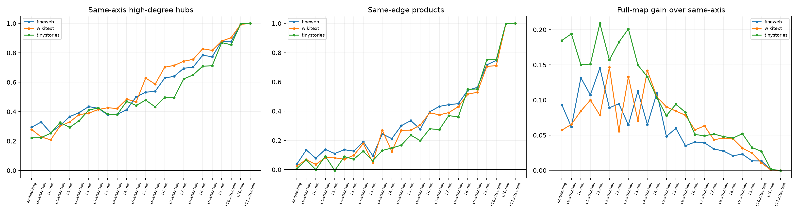

# Upstream depth telescope of sparse-graph hubs

The final 32 coordinates and selected edge products are frozen. At every embedding/attention/MLP half-block, the same residual directions are projected and only per-coordinate affine scales are fit on ordinary FineWeb states. A full 32-by-32 map is an upper probe for rotated information. All maps are frozen before disjoint FineWeb and OOD evaluation.

## Locked hypotheses

- **T0_trace_target_is_exact: supported.**
- **T1_layer10_residual_contains_same_axis_hubs: supported.**
- **T2_midlayer_contains_same_axis_hubs: not supported.**
- **T3_pair_grammar_is_present_before_final_attention: supported.**
- **T4_late_coordinates_do_not_require_rotation: supported.**
- **T5_readability_generally_increases_with_depth: supported.**
- **T6_depth_profile_transfers_ood: supported.**

High-degree hubs (degree >=3): `[0, 1, 2, 4, 6, 12, 15, 25, 27]`.

| Corpus | Embedding hub/edge R2 | L6 MLP hub/edge | L10 MLP hub/edge | L11 attention target | Full-map gain at L10 |
|---|---:|---:|---:|---:|---:|
| fineweb | 0.294/0.037 | 0.628/0.396 | 0.996/0.997 | 1.000/1.000 | 0.001 |
| wikitext | 0.278/0.025 | 0.702/0.389 | 0.993/0.996 | 1.000/1.000 | 0.000 |
| tinystories | 0.221/0.007 | 0.497/0.280 | 0.997/0.997 | 1.000/1.000 | 0.001 |

Same-axis success means the final coordinate is persistently present in the shared residual basis; full-map-only success means the information exists but rotates or mixes. Neither is causal provenance by itself. The next step uses finite boundary perturbations at the earliest strong stage to measure the actual transport matrix into final hubs and edge products.
