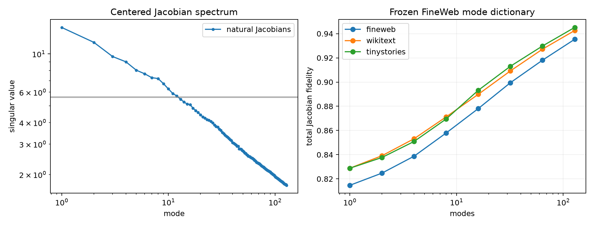

# Spectrum of natural transport Jacobians

Weight-derived 32-by-32 Layer-6-to-final MLP transport Jacobians were collected at 1,024 FineWeb sites. PCA was fit only there, then its mean and mode dictionary were frozen and tested on disjoint FineWeb and two OOD corpora. Column-wise shuffled matrices preserve every marginal entry distribution while destroying coordinated circuit modes.

## Locked hypotheses

- **P0_jacobian_variation_is_low_rank: not supported.**
- **P1_rank32_dictionary_is_high_fidelity: not supported.**
- **P2_rank64_dictionary_is_nearly_complete: not supported.**
- **P3_mode_dictionary_transfers_ood: supported.**
- **P4_spectrum_has_random_matrix_outliers: supported.**
- **P5_mean_transport_is_not_enough: supported.**

Centered effective rank: **155.4**. Leading/null ratio: **2.53**. Rank-16 centered variance: **0.441**.

| Corpus | Mean only | Rank 16 | Rank 32 | Rank 64 | Rank 128 |
|---|---:|---:|---:|---:|---:|
| fineweb | 0.798 | 0.878 | 0.899 | 0.918 | 0.935 |
| wikitext | 0.813 | 0.890 | 0.909 | 0.927 | 0.943 |
| tinystories | 0.816 | 0.893 | 0.913 | 0.930 | 0.945 |

This separates two problems: a compact mode dictionary may exist even when predicting its coefficients from local semantic variables remains difficult. Spectral outliers support reusable coordinated transport modes; they do not by themselves assign human meanings to those modes.
