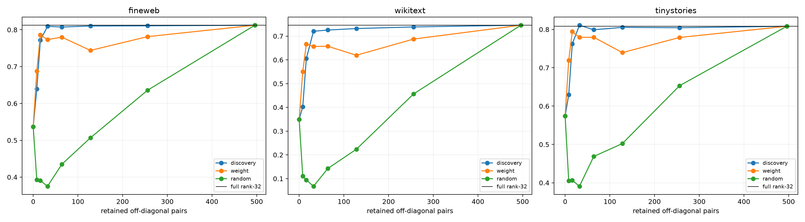

# Joint diagonalization of the compact quadratic router

The exact pooled-output forms are restricted to one ordinary-state rank-32 basis, then rotated using weights only to minimize joint off-diagonal energy. Diagonal-only execution asks whether the computation becomes independent scalar coordinates; frozen interaction-pair frontiers test how many relational terms are still needed.

## Locked hypotheses

- **J0_forms_are_approximately_jointly_diagonalizable: not supported.**
- **J1_diagonal_program_is_sufficient: not supported.**
- **J2_rotation_improves_diagonal_program: not supported.**
- **J3_diagonal_program_beats_random_rotation: supported.**
- **J4_canonical_axes_are_multistart_stable: supported.**
- **J5_cross_terms_are_causally_necessary: supported.**
- **J6_sixtyfour_cross_pairs_are_sufficient: supported.**
- **J7_discovery_pair_ranking_beats_weight_only: not supported.**

Off-diagonal energy: `0.885` → `0.553`; multistart loss CV `0.000`, axis overlap `0.959`.

| Corpus | Full / optimized diagonal / PCA diagonal / random diagonal | Discovery pairs 16/32/64/128 | Weight pairs 64 |
|---|---:|---:|---:|
| fineweb | 0.812/0.537/0.441/0.061 | 0.772/0.809/0.807/0.810 | 0.780 |
| wikitext | 0.746/0.350/0.221/0.026 | 0.605/0.720/0.726/0.732 | 0.657 |
| tinystories | 0.808/0.574/0.489/0.056 | 0.762/0.811/0.799/0.805 | 0.780 |

Joint diagonalization can reveal a neuron-like scalar code only if diagonal execution preserves the finite behavioral effect. Residual off-diagonal terms are explicit pairwise verbs in the compressed coordinate system—not evidence that either coordinate has two unrelated meanings. Axis multistart stability and pair-ranking controls prevent a visually sparse but non-identifiable rotation from being overinterpreted.
