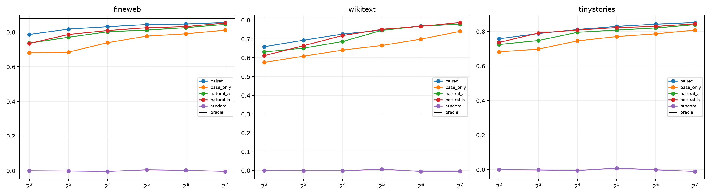

# Natural-basis red team of the quadratic router

The exact quadratic router is held fixed. Its shared input space is now learned either from newline-paired states, base states only, ordinary unedited states at four positions on either of two disjoint FineWeb slices, or a random control. No natural basis sees token-edit labels or write deltas.

## Locked hypotheses

- **N0_natural_rank16_is_sufficient: not supported.**
- **N1_target_conditioning_is_unnecessary: supported.**
- **N2_natural_basis_replicates_across_slices: supported.**
- **N3_natural_basis_beats_random: supported.**
- **N4_natural_basis_is_geometrically_stable: not supported.**
- **N5_behavioral_compression_exceeds_state_energy: not supported.**

| Corpus | Oracle | Rank-16 paired/base/natural-A/natural-B/random | Natural-A edit energy |
|---|---:|---:|---:|
| fineweb | 0.881 | 0.832/0.740/0.803/0.810/-0.004 | 0.635 |
| wikitext | 0.817 | 0.726/0.641/0.687/0.719/-0.001 | 0.540 |
| tinystories | 0.873 | 0.811/0.746/0.795/0.809/-0.004 | 0.642 |

Natural slice A/B rank-16 overlap: `0.732`.

If unedited-state bases match the paired basis, the compactness is a property of the naturally occupied state manifold rather than leakage from the chosen newline edit. This still does not make individual PCA axes semantic or unique; the stable object is the subspace plus the exact quadratic operator restricted to it.
