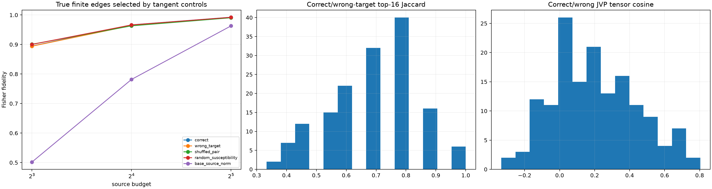

# Tangent-specificity red team for semantic source programs

The previously successful base-point JVP ranking is compared with an unrelated replacement target, a shuffled lexical-pair delta, a four-random-probe Jacobian susceptibility estimate, and static base-source magnitude. Every method only selects positions; the selected positions are evaluated with the same true finite source deltas. This isolates support prediction from direction prediction.

## Locked hypotheses

- **T1_correct_tangent_beats_wrong_target: not supported.**
- **T2_correct_tangent_beats_shuffled_pair_delta: not supported.**
- **T3_correct_tangent_beats_generic_random_susceptibility: not supported.**
- **T4_program_support_is_target_specific: supported.**
- **T5_generic_jacobian_susceptibility_beats_static_source_magnitude: supported.**
- **T6_correct_jvp_support_remains_robust: supported.**
- **T7_selection_is_much_better_than_linear_reconstruction: supported.**
- **T8_norm_selection_is_sign_blind: supported.**
- **T9_wrong_tangents_do_not_define_semantic_direction: supported.**
- **T10_support_is_instead_a_generic_contextual_susceptibility_map: not supported.**

| Budget | Correct | Wrong target | Shuffled pair | Random susceptibility | Base source |
|---:|---:|---:|---:|---:|---:|
| 8 | 0.895 | 0.894 | 0.901 | 0.900 | 0.502 |
| 16 | 0.967 | 0.964 | 0.963 | 0.966 | 0.782 |
| 32 | 0.992 | 0.991 | 0.991 | 0.992 | 0.963 |

Correct/wrong-target median top-16 Jaccard: **0.684**. Correct/wrong-target median source-tensor cosine: **0.185**. All-source correct-JVP reconstruction fidelity: **0.580**.

Because source norms are invariant under tangent sign, support selection cannot by itself specify whether an edit adds or removes a semantic property. A target-specific support result and a target-specific direction result are therefore distinct claims.
