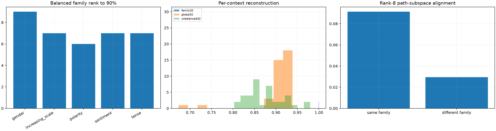

# Balanced semantic path subspaces for the layer-0 bilinear MLP

Every one of the 38 semantic edit contexts contributes equal Frobenius energy before fitting family and global output subspaces. Per-context, leave-one-lexical-pair-out, finite-delta, and canonical-alignment tests prevent a high-energy path from defining a misleadingly small aggregate rank.

## Locked hypotheses

- **B1_every_individual_semantic_path_is_low_rank: supported.**
- **B2_each_balanced_semantic_family_is_compact: supported.**
- **B3_a_balanced_global_semantic_subspace_is_moderately_compact: supported.**
- **B4_family_rank32_is_robust_per_context: supported.**
- **B5_leave_one_pair_out_family_transfer_is_useful: not supported.**
- **B6_family_bases_beat_the_global_basis_at_fixed_rank: not supported.**
- **B7_same_family_path_subspaces_are_more_aligned: supported.**
- **B8_unbalanced_global_rank_hides_low_energy_paths: not supported.**
- **B9_balanced_global_rank64_is_robust_per_context: supported.**
- **B10_finite_mlp_changes_are_captured_by_family_bases: supported.**

| Family | Balanced rank90/rank99 | Worst member family-rank32 | Mean held-out-pair rank32 |
|---|---:|---:|---:|
| gender | 9/21 | 0.998 | 0.417 |
| increasing_scale | 7/15 | 1.000 | 0.137 |
| polarity | 6/11 | 1.000 | 0.210 |
| sentiment | 7/13 | 1.000 | 0.222 |
| tense | 7/14 | 1.000 | 0.507 |

Balanced global rank-90%: **31**; unbalanced rank-90%: **26**. Worst per-context global rank-32 fidelity is **0.673** balanced versus **0.803** unbalanced. Same-family versus different-family rank-8 alignment is **0.091** versus **0.029**.

Equal path weighting asks for a reusable coordinate system rather than a variance-optimal summary of the most energetic edits. Leave-pair-out transfer is the stronger semantic test: a compact in-sample union can still be a lookup table over observed trajectories.
