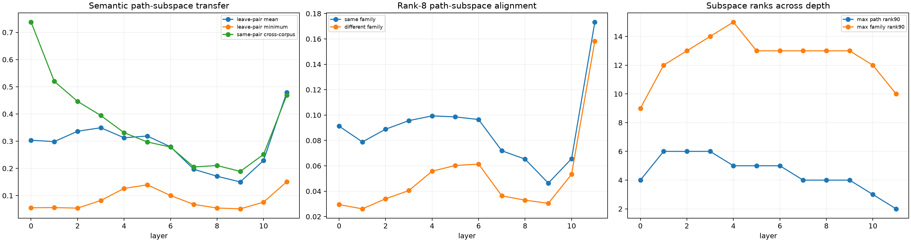

# Semantic MLP path-subspace transfer across depth

The same 38 lexical substitutions are differentiated along 65-point input paths through every bilinear MLP. At each layer, equally weighted family bases are tested in sample, across corpora for the same lexical pair, and on lexical pairs entirely excluded from basis fitting. This asks whether pair-specific low-rank trajectories become reusable semantic computations with depth.

## Locked hypotheses

- **D1_leave_pair_out_transfer_improves_with_depth: supported.**
- **D2_some_layer_has_useful_family_transfer: not supported.**
- **D3_some_layer_has_a_robust_held_out_floor: not supported.**
- **D4_same_family_alignment_emerges: supported.**
- **D5_same_pair_cross_corpus_transfer_exceeds_family_transfer: not supported.**
- **D6_individual_paths_remain_low_rank_across_depth: supported.**
- **D7_in_sample_family_subspaces_remain_compact: supported.**
- **D8_semantic_reuse_has_a_distinct_best_layer: supported.**
- **D9_late_layers_are_more_semantic_than_layer_zero: not supported.**
- **D10_no_layer_has_strong_universal_family_abstraction: supported.**

| Layer | Leave-pair mean/min | Same-pair cross-corpus | Same/different alignment | Max individual rank90 | Min in-sample family32 |
|---:|---:|---:|---:|---:|---:|
| 0 | 0.303/0.055 | 0.738 | 0.091/0.029 | 4 | 0.998 |
| 1 | 0.298/0.056 | 0.520 | 0.079/0.026 | 6 | 0.990 |
| 2 | 0.337/0.054 | 0.446 | 0.089/0.034 | 6 | 0.987 |
| 3 | 0.349/0.082 | 0.394 | 0.096/0.041 | 6 | 0.977 |
| 4 | 0.313/0.126 | 0.331 | 0.099/0.056 | 5 | 0.979 |
| 5 | 0.319/0.139 | 0.297 | 0.099/0.060 | 5 | 0.985 |
| 6 | 0.279/0.100 | 0.278 | 0.097/0.061 | 5 | 0.985 |
| 7 | 0.197/0.068 | 0.205 | 0.072/0.036 | 4 | 0.982 |
| 8 | 0.171/0.054 | 0.211 | 0.065/0.033 | 4 | 0.986 |
| 9 | 0.150/0.051 | 0.189 | 0.046/0.030 | 4 | 0.988 |
| 10 | 0.229/0.076 | 0.251 | 0.066/0.053 | 3 | 0.992 |
| 11 | 0.480/0.151 | 0.469 | 0.173/0.158 | 2 | 0.997 |

Best mean leave-pair-out transfer is **0.480** at layer **11**. The best worst-context floor is **0.151** at layer **11**.

Low path rank is descriptive compression. Same-pair cross-corpus transfer tests lexical recurrence; leave-pair-out family transfer is the stronger test of a reusable semantic operator. These can move differently with depth.
