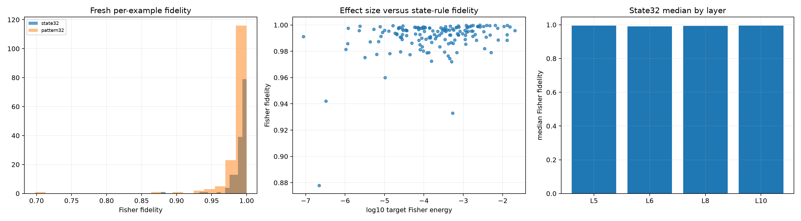

# Fresh individual-example red team of semantic source programs

For every lexical pair, the first two deterministic windows were used in the aggregate semantic-transfer audit. This preregistered follow-up evaluates the third window, producing 38 fresh examples and 152 layer-example effects. Aggregate Fisher weighting is removed: thresholds apply to individual examples and layers.

## Locked hypotheses

- **I1_state_norm32_is_robust_per_example: supported.**
- **I2_state_norm32_has_a_high_lower_tail: supported.**
- **I3_state_norm16_is_useful_per_example: supported.**
- **I4_pattern32_is_robust_per_example: not supported.**
- **I5_local_state_rule_matches_the_oracle_at_32: supported.**
- **I6_local_state_rule_beats_recency_at_32: supported.**
- **I7_success_is_not_an_effect_size_artifact: not supported.**
- **I8_every_layer_has_high_median_fidelity: supported.**
- **I9_every_semantic_family_has_a_robust_minimum: supported.**
- **I10_source_topology_still_is_not_semantic: supported.**

State-norm top-32: mean **0.991**, median **0.995**, fifth percentile **0.976**, minimum **0.878**.

State-norm top-16 fifth percentile: **0.793**. Pattern-change top-32 minimum: **0.698**. State32-versus-log-effect correlation: **0.316**.

| Layer | State32 median |
|---:|---:|
| 5 | 0.995 |
| 6 | 0.991 |
| 8 | 0.994 |
| 10 | 0.996 |

| Family | State32 minimum |
|---|---:|
| sentiment | 0.977 |
| gender | 0.974 |
| tense | 0.960 |
| increasing_scale | 0.878 |
| polarity | 0.979 |

Same-family versus different-family oracle-position Jaccard is **0.268** versus **0.269**. The local tensor rule can therefore be predictively stable even when the selected absolute positions carry no semantic-family identity.
