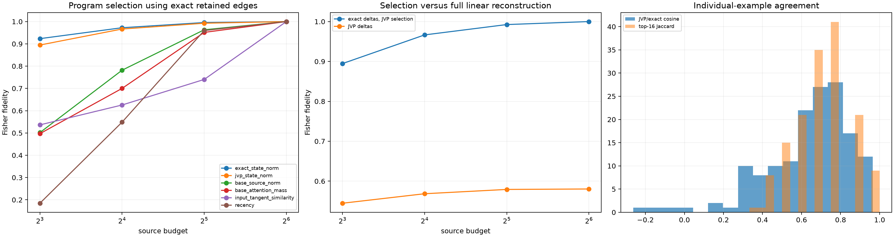

# Base-point JVP prediction of semantic source programs

The normalized embedding difference between each lexical pair is propagated once through a forward-mode Jacobian-vector product of the tensor network. This predicts every layer's final-destination source contribution change from the base point and input tangent, without running the finite counterfactual state. Selection fidelity uses exact finite deltas only after the JVP has selected positions; reconstruction fidelity inserts the JVP-predicted deltas themselves.

## Locked hypotheses

- **J1_manual_differentiable_trace_matches_native_sources: supported.**
- **J2_jvp_source_delta_has_high_directional_agreement: not supported.**
- **J3_jvp_ranking_selects_a_high_fidelity_program: supported.**
- **J4_jvp_selection_is_close_to_counterfactual_selection: supported.**
- **J5_jvp_prediction_reconstructs_behavior_not_only_ranking: not supported.**
- **J6_jvp_beats_static_base_shortcuts: supported.**
- **J7_jvp_selection_transfers_across_layers_corpora_and_families: supported.**
- **J8_jvp_and_exact_programs_overlap: supported.**
- **J9_input_similarity_alone_is_not_the_explanation: supported.**
- **J10_predictive_success_is_not_confined_to_the_edited_position: supported.**

## Aggregate program frontier

| Budget | Exact-state selector | JVP selector | JVP reconstruction | Base source | Base attention | Input similarity | Recency |
|---:|---:|---:|---:|---:|---:|---:|---:|
| 8 | 0.923 | 0.895 | 0.545 | 0.502 | 0.497 | 0.536 | 0.185 |
| 16 | 0.972 | 0.967 | 0.568 | 0.782 | 0.700 | 0.626 | 0.548 |
| 32 | 0.996 | 0.992 | 0.579 | 0.963 | 0.951 | 0.740 | 0.960 |
| 64 | 1.000 | 1.000 | 0.580 | 1.000 | 1.000 | 1.000 | 1.000 |

Median JVP/exact source-tensor cosine: **0.680**. Median exact/JVP top-16 Jaccard: **0.684**. Maximum manual-source recomposition relative error: **8.54e-08**.

The JVP predictor knows the proposed token replacement through its normalized embedding tangent, but it does not use the finite changed hidden states, target logits, unembedding, or downstream Fisher direction. It is therefore a local mechanistic predictor, not a context-free semantic circuit and not a zero-information forecast.
