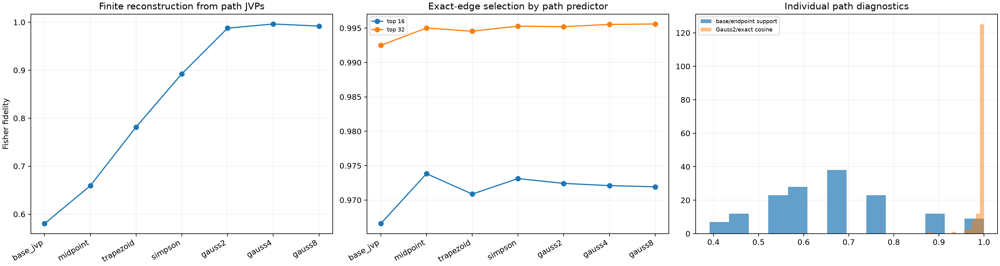

# Path-integrated tensor JVPs for finite semantic edits

The normalized source-token embedding is moved along the straight chord to the replacement-token embedding. Source-contribution Jacobian-vector products are integrated along this path with midpoint, trapezoid, Simpson, and Gauss-Legendre rules. This tests whether the failed base-point amplitude prediction reflects smooth curvature or a discontinuous change of computational regime.

## Locked hypotheses

- **P1_base_jvp_reproduces_the_prior_failure: supported.**
- **P2_midpoint_substantially_improves_finite_reconstruction: not supported.**
- **P3_two_point_gauss_is_a_useful_finite_program: supported.**
- **P4_four_point_gauss_nearly_reconstructs_the_finite_effect: supported.**
- **P5_quadrature_error_converges: not supported.**
- **P6_gauss2_recovers_source_tensor_direction: supported.**
- **P7_support_was_easier_than_amplitude: supported.**
- **P8_path_integral_transfers_across_layers_corpora_and_families: supported.**
- **P9_local_support_is_stable_along_the_path: supported.**
- **P10_four_points_are_close_to_eight: supported.**

| Method | Full predicted-delta fidelity | Top-16 selection | Top-32 selection | Individual q05 |
|---|---:|---:|---:|---:|
| base_jvp | 0.580 | 0.967 | 0.992 | -0.399 |
| midpoint | 0.659 | 0.974 | 0.995 | -0.200 |
| trapezoid | 0.782 | 0.971 | 0.995 | 0.349 |
| simpson | 0.892 | 0.973 | 0.995 | 0.487 |
| gauss2 | 0.988 | 0.972 | 0.995 | 0.925 |
| gauss4 | 0.996 | 0.972 | 0.996 | 0.983 |
| gauss8 | 0.992 | 0.972 | 0.996 | 0.996 |

Gauss-2 median predicted/exact source-tensor cosine: **0.998**. Base-versus-endpoint derivative top-16 Jaccard: **0.684**. Worst layer/corpus/family Gauss-4 aggregate fidelity: **0.989**.

Path integration is an explicit finite-effect explanation in the model's native tensor coordinates. It uses the proposed input edit and several local linear evaluations; it is not a context-free feature dictionary or a claim that a single neuron carries the edit.
