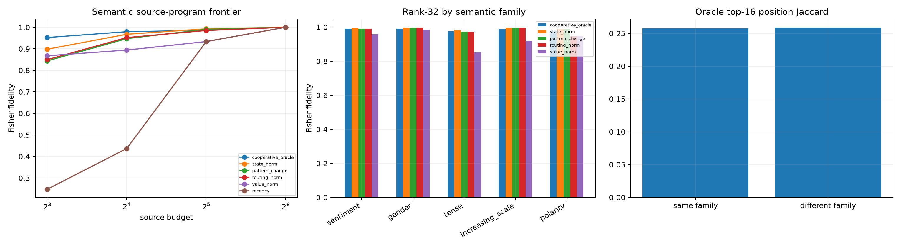

# Semantic transfer of the source-edge program

Nineteen lexical substitutions across sentiment, gender, tense, scale, and polarity are evaluated at a fixed 16-token distance on FineWeb and TinyStories. The downstream cooperative oracle is compared with prediction rules using only local tensor quantities: exact source-edge state magnitude, attention-pattern change, routing magnitude, value magnitude, and fixed recency.

## Locked hypotheses

- **S1_semantic_messages_have_cooperative_source_programs: supported.**
- **S2_local_state_norm_predicts_the_program: supported.**
- **S3_local_state_norm_is_robust_at_32: supported.**
- **S4_pattern_change_alone_is_sufficient: supported.**
- **S5_value_and_routing_norms_have_distinct_regimes: not supported.**
- **S6_tensor_local_rule_beats_recency: supported.**
- **S7_state_norm_transfers_to_every_semantic_family: supported.**
- **S8_semantic_final_messages_are_behaviorally_nontrivial: supported.**
- **S9_oracle_topology_is_semantically_recurrent: not supported.**
- **S10_semantic_program_is_not_newline_specific: supported.**

## Aggregate frontier

| Budget | Oracle | State norm | Pattern change | Routing norm | Value norm | Recency |
|---:|---:|---:|---:|---:|---:|---:|
| 8 | 0.952 | 0.898 | 0.844 | 0.850 | 0.868 | 0.248 |
| 16 | 0.979 | 0.967 | 0.947 | 0.952 | 0.894 | 0.437 |
| 32 | 0.986 | 0.993 | 0.990 | 0.985 | 0.934 | 0.934 |
| 64 | 1.000 | 1.000 | 1.000 | 1.000 | 1.000 | 1.000 |

## Rank-32 family transfer

| Family | Oracle | State norm | Pattern | Routing | Value |
|---|---:|---:|---:|---:|---:|
| sentiment | 0.990 | 0.994 | 0.990 | 0.991 | 0.958 |
| gender | 0.991 | 0.996 | 0.996 | 0.997 | 0.983 |
| tense | 0.974 | 0.982 | 0.973 | 0.971 | 0.851 |
| increasing_scale | 0.989 | 0.996 | 0.995 | 0.996 | 0.918 |
| polarity | 0.979 | 0.989 | 0.989 | 0.945 | 0.946 |

Median full final-destination KL: FineWeb **8.78e-05**, TinyStories **7.04e-05**. Same-family versus different-family oracle-position Jaccard: **0.258** versus **0.259**.

The cooperative oracle uses downstream target information. State, pattern, routing, value, and recency rankings do not. Success of a local rule establishes predictive intervention compression, not semantic meaning for any selected source position.
