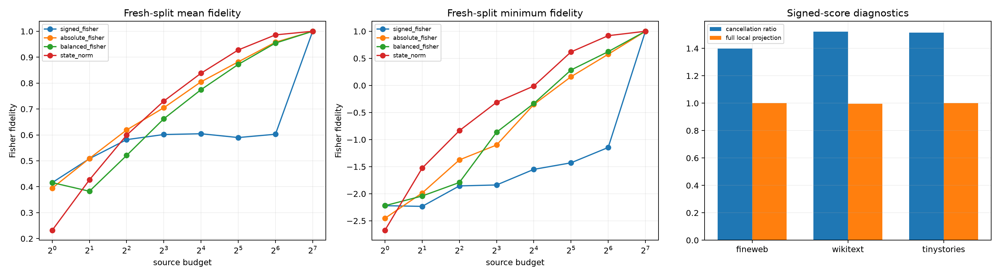

# Fresh-split source-cancellation red team

The first source-edge audit found a small absolute-score participation ratio but poor one-sided subset fidelity. This preregistered replication uses fresh examples, adds an explicitly sign-balanced ranking, measures positive/negative local Fisher score cancellation, and corrects the recomposition-logit diagnostic.

## Locked hypotheses

- **C1_full_local_score_predicts_the_finite_target: supported.**
- **C2_positive_and_negative_source_evidence_both_matter: supported.**
- **C3_two_sided_selection_beats_one_sided_selection: supported.**
- **C4_sixtyfour_two_sided_sources_are_robust: not supported.**
- **C5_state_magnitude_is_a_competitive_proxy: supported.**
- **C6_participation_understates_required_support: supported.**
- **C7_balancing_signs_is_not_enough: not supported.**
- **C8_cancellation_strength_transfers_across_corpora: supported.**
- **C9_the_edit_edge_is_not_the_message: not supported.**
- **C10_no_fixed_sixteen_position_skeleton_dominates: supported.**

## Fresh-split frontier

| Budget | Signed mean/min | Absolute mean/min | Balanced mean/min | State mean/min |
|---:|---:|---:|---:|---:|
| 1 | 0.416/-2.220 | 0.395/-2.453 | 0.416/-2.220 | 0.232/-2.674 |
| 2 | 0.508/-2.233 | 0.509/-1.986 | 0.383/-2.042 | 0.427/-1.527 |
| 4 | 0.582/-1.855 | 0.619/-1.375 | 0.521/-1.792 | 0.599/-0.835 |
| 8 | 0.602/-1.838 | 0.705/-1.100 | 0.662/-0.864 | 0.731/-0.311 |
| 16 | 0.605/-1.550 | 0.805/-0.352 | 0.775/-0.334 | 0.838/-0.011 |
| 32 | 0.590/-1.429 | 0.882/0.161 | 0.872/0.285 | 0.928/0.619 |
| 64 | 0.603/-1.146 | 0.958/0.576 | 0.955/0.624 | 0.986/0.919 |
| 128 | 1.000/1.000 | 1.000/1.000 | 1.000/1.000 | 1.000/1.000 |

| Corpus | Median cancellation ratio | Median full local projection |
|---|---:|---:|
| fineweb | 1.398 | 1.001 |
| wikitext | 1.521 | 0.997 |
| tinystories | 1.516 | 1.002 |

Median participation is **7.5**, yet top-16 absolute selection has a worst-condition fidelity of **-0.352**. The recurrent absolute-position top-16 accounts for **0.412** of selections. These quantities answer different questions: participation measures concentration of signed local scores; finite subset fidelity measures whether omitted positive and negative edges still cancel correctly.
