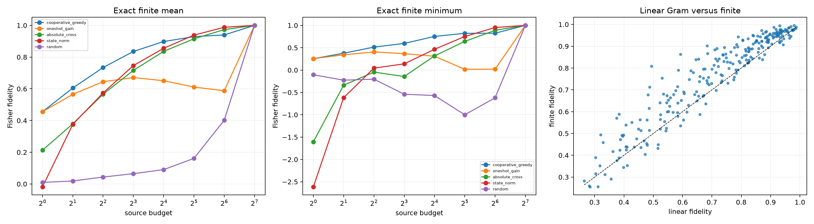

# Cooperative downstream-Fisher source program

For each example, layer, and source position, the finite logit effect of inserting that one exact tensor edge is measured. These effects define an implicit downstream Fisher Gram. Forward selection repeatedly chooses the source edge that most reduces the current additive-logit residual, accounting for self-energy and overlap with already selected edges. Frozen state-norm, one-shot gain, absolute-cross, and random rankings are controls.

## Locked hypotheses

- **G1_individual_edge_effects_are_approximately_additive: supported.**
- **G2_sixteen_cooperative_edges_are_useful: supported.**
- **G3_thirtytwo_cooperative_edges_are_robust: supported.**
- **G4_cooperative_selection_beats_state_norm: not supported.**
- **G5_cooperative_selection_beats_oneshot_gain: supported.**
- **G6_cooperative_frontier_is_monotone: supported.**
- **G7_linear_gram_prediction_tracks_finite_behavior: supported.**
- **G8_cooperative_program_uses_both_signs: supported.**
- **G9_thirtytwo_edges_are_nearly_sufficient_on_average: supported.**
- **G10_no_fixed_source_skeleton_explains_the_program: supported.**

## Exact finite frontier

| Budget | Cooperative mean/min | One-shot gain mean/min | Absolute cross mean/min | State norm mean/min |
|---:|---:|---:|---:|---:|
| 1 | 0.455/0.255 | 0.455/0.255 | 0.213/-1.606 | -0.018/-2.614 |
| 2 | 0.605/0.377 | 0.565/0.342 | 0.379/-0.339 | 0.376/-0.618 |
| 4 | 0.734/0.514 | 0.645/0.406 | 0.566/-0.045 | 0.574/0.044 |
| 8 | 0.836/0.596 | 0.671/0.367 | 0.716/-0.144 | 0.746/0.139 |
| 16 | 0.898/0.753 | 0.651/0.309 | 0.836/0.317 | 0.856/0.465 |
| 32 | 0.929/0.823 | 0.611/0.018 | 0.915/0.642 | 0.938/0.752 |
| 64 | 0.940/0.825 | 0.588/0.020 | 0.974/0.890 | 0.988/0.952 |
| 128 | 1.000/1.000 | 1.000/1.000 | 1.000/1.000 | 1.000/1.000 |

Mean all-edge additive-logit fidelity: **0.973**. Linear-Gram versus exact-finite correlation: **0.946**. Negative-initial-cross share among the first 16 cooperative selections: **0.202**. Global 16-position skeleton share: **0.382**.

This is an adaptive oracle program, not a deployable fixed circuit. It tests whether the cancellation web has a sparse cooperative description once the correct quadratic metric is used.
