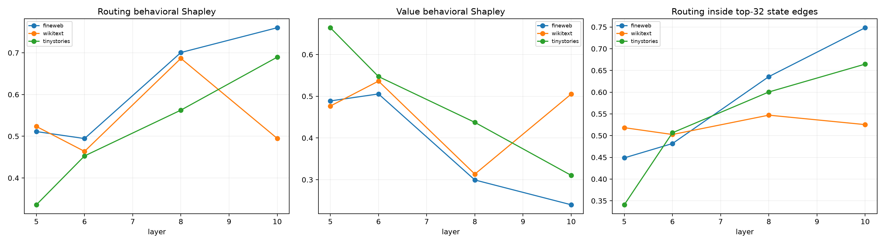

# Routing-versus-value source audit

Every final-destination head/source product is split by the exact two-factor Shapley identity into attention-pattern routing change and mixed-value change. These terms recompose before the head output projections. Their state projections are compared with finite downstream behavioral Shapley, isolated-effect additivity, and the state-norm top-32 source program.

## Locked hypotheses

- **R1_routing_value_recomposition_is_exact: not supported.**
- **R2_attention_mass_is_conserved: supported.**
- **R3_pre_edit_value_changes_are_causally_zero: supported.**
- **R4_routing_dominates_behavior: not supported.**
- **R5_value_changes_are_sometimes_material: supported.**
- **R6_isolated_routing_and_value_effects_add: not supported.**
- **R7_state_and_behavior_agree_on_the_larger_factor: not supported.**
- **R8_large_source_edges_are_mostly_routing: not supported.**
- **R9_routing_has_structurally_balanced_sign_mass: supported.**
- **R10_routing_dominance_transfers_ood: not supported.**

The strict `1e-5` recomposition gate failed from float32 summation order:
maximum relative write error is `1.90e-05` and maximum propagated-logit
disagreement is `3.19e-05`. The algebraic product-Shapley identity is exact;
the locked numerical failure is retained.

| Corpus | Position | Layer | Routing/value state | Routing/value behavior | Isolated sum fidelity | Top32 routing |
|---|---:|---:|---:|---:|---:|---:|
| fineweb | 63 | 5 | 0.456/0.544 | 0.566/0.434 | 0.999 | 0.538 |
| fineweb | 63 | 6 | 0.444/0.556 | 0.513/0.487 | 0.998 | 0.529 |
| fineweb | 63 | 8 | 0.648/0.352 | 0.749/0.251 | 0.999 | 0.665 |
| fineweb | 63 | 10 | 0.602/0.398 | 0.720/0.280 | 0.997 | 0.598 |
| fineweb | 95 | 5 | 0.290/0.710 | 0.324/0.676 | 0.999 | 0.432 |
| fineweb | 95 | 6 | 0.368/0.632 | 0.308/0.692 | 0.999 | 0.475 |
| fineweb | 95 | 8 | 0.580/0.420 | 0.628/0.372 | 0.998 | 0.596 |
| fineweb | 95 | 10 | 0.898/0.102 | 0.833/0.167 | 0.999 | 0.900 |
| fineweb | 119 | 5 | 0.381/0.619 | 0.644/0.356 | 0.988 | 0.376 |
| fineweb | 119 | 6 | 0.439/0.561 | 0.663/0.337 | 0.996 | 0.441 |
| fineweb | 119 | 8 | 0.646/0.354 | 0.725/0.275 | 0.993 | 0.647 |
| fineweb | 119 | 10 | 0.753/0.247 | 0.727/0.273 | 0.998 | 0.748 |
| wikitext | 63 | 5 | 0.460/0.540 | 0.524/0.476 | 0.764 | 0.717 |
| wikitext | 63 | 6 | 0.423/0.577 | 0.420/0.580 | 0.999 | 0.555 |
| wikitext | 63 | 8 | 0.451/0.549 | 0.576/0.424 | 0.927 | 0.409 |
| wikitext | 63 | 10 | 0.473/0.527 | 0.287/0.713 | 0.978 | 0.459 |
| wikitext | 95 | 5 | 0.437/0.563 | 0.808/0.192 | 0.989 | 0.517 |
| wikitext | 95 | 6 | 0.452/0.548 | 0.520/0.480 | 0.995 | 0.515 |
| wikitext | 95 | 8 | 0.593/0.407 | 0.780/0.220 | 0.961 | 0.604 |
| wikitext | 95 | 10 | 0.411/0.589 | 0.402/0.598 | 0.987 | 0.397 |
| wikitext | 119 | 5 | 0.256/0.744 | 0.239/0.761 | 0.992 | 0.321 |
| wikitext | 119 | 6 | 0.391/0.609 | 0.451/0.549 | 0.986 | 0.438 |
| wikitext | 119 | 8 | 0.624/0.376 | 0.704/0.296 | 0.990 | 0.628 |
| wikitext | 119 | 10 | 0.728/0.272 | 0.795/0.205 | 0.996 | 0.721 |
| tinystories | 63 | 5 | 0.304/0.696 | 0.354/0.646 | 0.998 | 0.361 |
| tinystories | 63 | 6 | 0.463/0.537 | 0.500/0.500 | 0.997 | 0.496 |
| tinystories | 63 | 8 | 0.576/0.424 | 0.588/0.412 | 0.986 | 0.592 |
| tinystories | 63 | 10 | 0.562/0.438 | 0.551/0.449 | 1.000 | 0.553 |
| tinystories | 95 | 5 | 0.368/0.632 | 0.478/0.522 | 0.993 | 0.424 |
| tinystories | 95 | 6 | 0.447/0.553 | 0.441/0.559 | 0.999 | 0.594 |
| tinystories | 95 | 8 | 0.566/0.434 | 0.581/0.419 | 0.998 | 0.568 |
| tinystories | 95 | 10 | 0.801/0.199 | 0.809/0.191 | 1.000 | 0.798 |
| tinystories | 119 | 5 | 0.184/0.816 | 0.176/0.824 | 0.996 | 0.237 |
| tinystories | 119 | 6 | 0.378/0.622 | 0.418/0.582 | 0.985 | 0.430 |
| tinystories | 119 | 8 | 0.628/0.372 | 0.519/0.481 | 0.995 | 0.641 |
| tinystories | 119 | 10 | 0.649/0.351 | 0.709/0.291 | 0.999 | 0.643 |

Attention-row normalization makes the routing coefficients a conserved redistribution: their signed pattern changes sum to zero per head. Whether this structural cancellation explains the behavior depends on the routing/value causal allocation rather than conservation alone.
