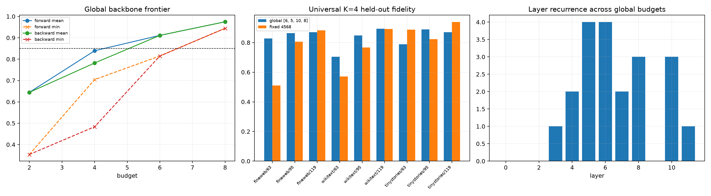

# Universal attention-backbone audit

One forward-greedy and one backward-elimination layer set are optimized jointly over all nine corpus-by-distance selection conditions, then evaluated on disjoint rows. Fixed candidate sets `{4,5,6,8}` and `{3,4,5,6}` test the recurrent middle-layer pattern without further search.

## Locked hypotheses

- **U1_universal_four_layer_backbone_is_useful: supported.**
- **U2_universal_six_layer_backbone_is_nearly_sufficient: not supported.**
- **U3_layers_five_and_six_are_in_the_global_core: supported.**
- **U4_global_search_prefers_the_observed_middle_core: supported.**
- **U5_fixed_4568_core_generalizes: not supported.**
- **U6_global_frontier_is_monotone: supported.**
- **U7_one_global_set_does_not_solve_everything: not supported.**
- **U8_backbone_transfer_is_not_fineweb_specific: supported.**

| Budget | Better method/set | Mean fidelity | Minimum fidelity |
|---:|---|---:|---:|
| 2 | forward / [6, 5] | 0.644 | 0.354 |
| 4 | forward / [6, 5, 10, 8] | 0.839 | 0.704 |
| 6 | forward / [6, 5, 10, 8, 7, 4] | 0.911 | 0.815 |
| 8 | forward / [6, 5, 10, 8, 7, 4, 11, 3] | 0.975 | 0.944 |

| Condition | Global K4 | Fixed 4568 | Fixed 3456 |
|---|---:|---:|---:|
| fineweb/63 | 0.827 | 0.510 | 0.394 |
| fineweb/95 | 0.863 | 0.805 | 0.542 |
| fineweb/119 | 0.870 | 0.882 | 0.850 |
| wikitext/63 | 0.704 | 0.571 | 0.482 |
| wikitext/95 | 0.848 | 0.767 | 0.658 |
| wikitext/119 | 0.894 | 0.891 | 0.830 |
| tinystories/63 | 0.789 | 0.888 | 0.915 |
| tinystories/95 | 0.888 | 0.823 | 0.649 |
| tinystories/119 | 0.870 | 0.938 | 0.931 |

A universal subset is a reusable intervention interface, not proof that those layers alone compute every route. Condition-specific layers can compensate for omitted writes, and replacement patches inject native changed-run messages whose internal content is analyzed separately by the QK/OV audit.
