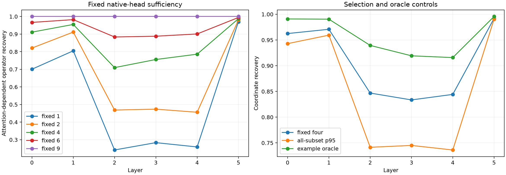

# Attention-head roles in the early operator interface

Each Layer-0--5 attention write is exactly split into its nine projected native-head writes. Fixed head subsets are selected only on discovery FineWeb to reconstruct the layer's rank-64 operator-state coordinates. Evaluation reports recovery relative to deleting all attention: 0 is the mixed-residual-only baseline and 1 is the complete native attention write.

Maximum summed-head recomposition error: `4.52e-07`.

## Locked hypotheses

- **A0_heads_recompose_attention: supported.**
- **A1_four_fixed_heads_recover_attention_operator: not supported.**
- **A2_four_heads_are_nontrivially_selected: not supported.**
- **A3_fixed_four_approaches_example_oracle: supported.**
- **A4_two_heads_are_insufficient: not supported.**
- **A5_single_heads_have_supervised_roles: supported.**
- **A6_source_roles_are_split_stable: supported.**

| Layer | Fixed 1/2/4/6 head operator recovery | Four heads | Four-head coordinate / all-subset p95 / example oracle | Source-role same/shuffled-p95 |
|---:|---:|---|---:|---:|
| 0 | 0.701/0.821/0.911/0.967 | [3, 4, 7, 8] | 0.963 / 0.943 / 0.991 | 0.992/0.787 |
| 1 | 0.805/0.912/0.955/0.982 | [1, 5, 7, 8] | 0.971 / 0.959 / 0.990 | 0.993/0.791 |
| 2 | 0.242/0.469/0.710/0.884 | [0, 2, 6, 7] | 0.847 / 0.742 / 0.939 | 0.989/0.746 |
| 3 | 0.284/0.474/0.756/0.888 | [0, 4, 5, 6] | 0.834 / 0.745 / 0.919 | 0.991/0.842 |
| 4 | 0.259/0.456/0.786/0.901 | [0, 1, 5, 7] | 0.844 / 0.736 / 0.916 | 0.988/0.886 |
| 5 | 0.970/0.980/0.988/0.994 | [1, 6, 7, 8] | 0.992 / 0.991 / 0.996 | 0.950/0.834 |

## Strongest validation-selected single-head semantic decoders

- Layer 0: word_continuation→H6 (0.939 vs full 0.928), leading_space→H6 (0.857 vs full 0.861), negation→H3 (0.835 vs full 0.865)
- Layer 1: word_continuation→H2 (0.940 vs full 0.945), leading_space→H2 (0.858 vs full 0.869), colon_semicolon→H7 (0.838 vs full 0.840)
- Layer 2: word_continuation→H5 (0.948 vs full 0.943), leading_space→H6 (0.862 vs full 0.864), time_unit→H7 (0.861 vs full 0.826)
- Layer 3: word_continuation→H3 (0.942 vs full 0.933), leading_space→H7 (0.859 vs full 0.865), newline→H6 (0.847 vs full 0.847)
- Layer 4: word_continuation→H5 (0.944 vs full 0.929), comma→H0 (0.875 vs full 0.874), leading_space→H3 (0.866 vs full 0.862)
- Layer 5: word_continuation→H5 (0.949 vs full 0.940), leading_space→H4 (0.877 vs full 0.873), comma→H4 (0.876 vs full 0.875)

## Guardrails

A head subset is a native architectural decomposition, but high recovery does not make a head monosemantic. The per-example oracle uses evaluation outcomes and is only an upper control. The all-subset p95 is not an independent-sample significance test because subsets share heads. Semantic labels describe the next token and use a validation split for head selection. Source-role stability uses log enrichment relative to value-norm-weighted causally available sources, rather than raw corpus feature frequencies; it still establishes a routing signature, not the head's complete causal purpose.
