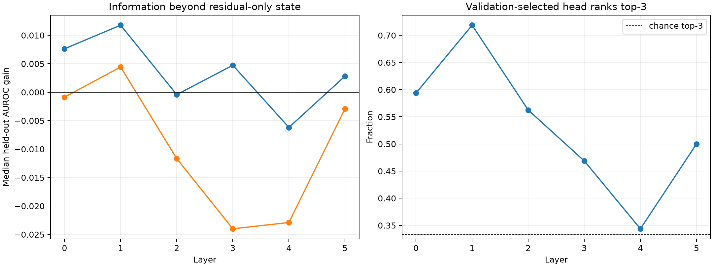

# Incremental semantic red team for early attention heads

The earlier one-head probes retained the complete mixed residual and therefore could inherit semantic information from it. Here each candidate is represented as residual-only operator coordinates plus that head's operator-coordinate delta. Heads are selected on the second half of discovery data by improvement over the residual decoder, then refitted on all discovery data and evaluated on disjoint FineWeb. Delta-only and exact-current-token controls are reported separately.

## Locked hypotheses

- **S0_full_attention_adds_semantic_information: not supported.**
- **S1_one_head_captures_half_attention_gain: not supported.**
- **S2_raw_head_semantics_were_residual_confounded: not supported.**
- **S3_increment_survives_current_token_control: supported.**
- **S4_validation_head_selection_generalizes: supported.**
- **S5_large_unique_single_head_roles_exist: not supported.**

| Layer | Median full-attention AUROC gain | Median selected-head gain | Median head-delta-only AUROC | Validation head top-3 rate |
|---:|---:|---:|---:|---:|
| 0 | +0.008 | -0.001 | 0.602 | 0.594 |
| 1 | +0.012 | +0.004 | 0.768 | 0.719 |
| 2 | -0.000 | -0.012 | 0.610 | 0.562 |
| 3 | +0.005 | -0.024 | 0.616 | 0.469 |
| 4 | -0.006 | -0.023 | 0.630 | 0.344 |
| 5 | +0.003 | -0.003 | 0.749 | 0.500 |

## Largest held-out incremental roles

- Layer 1 H7 `negation`: AUROC 0.751 → 0.857 (full 0.846); within-token gain +0.209.
- Layer 1 H6 `non_ascii`: AUROC 0.739 → 0.818 (full 0.769); within-token gain +0.282.
- Layer 0 H6 `opening_delimiter`: AUROC 0.558 → 0.615 (full 0.499); within-token gain +0.324.
- Layer 5 H6 `opening_delimiter`: AUROC 0.649 → 0.702 (full 0.699); within-token gain -0.224.
- Layer 0 H8 `numeric`: AUROC 0.788 → 0.841 (full 0.871); within-token gain +0.388.
- Layer 0 H0 `time_unit`: AUROC 0.767 → 0.811 (full 0.791); within-token gain -0.105.
- Layer 3 H0 `opening_delimiter`: AUROC 0.597 → 0.640 (full 0.632); within-token gain -0.007.
- Layer 2 H1 `dash`: AUROC 0.766 → 0.807 (full 0.791); within-token gain +0.344.
- Layer 3 H4 `numeric`: AUROC 0.834 → 0.871 (full 0.859); within-token gain +0.022.
- Layer 1 H1 `boolean`: AUROC 0.608 → 0.642 (full 0.591); within-token gain +0.084.
- Layer 0 H7 `all_caps`: AUROC 0.770 → 0.803 (full 0.780); within-token gain -0.057.
- Layer 4 H5 `time_unit`: AUROC 0.815 → 0.845 (full 0.761); within-token gain +0.129.

## Guardrails

Incremental linear decoding is conditional evidence, not a unique causal allocation: correlated heads can make individually useful information redundant, and concatenating a head delta doubles feature dimension relative to the residual baseline. Validation-based head selection and disjoint evaluation prevent direct test leakage but do not correct for testing many feature-layer cells. A later finite head ablation must verify any specific semantic role retained here.
