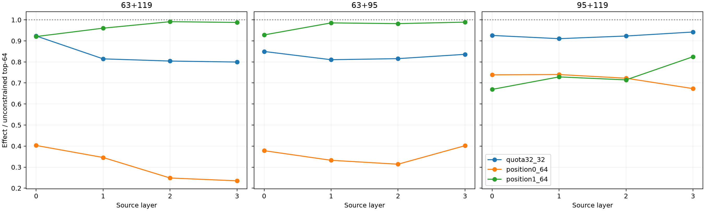

# Quota red team of balanced two-source coalitions

The strength-balanced edits are replayed with four causal allocations: an unconstrained global top 64, a forced 32+32 split, and top 64 restricted to either source position. All rankings use the exact local contribution `activation change × suffix gradient`, followed by full nonlinear suffix recomputation.

## Locked hypotheses

- **Q0_global_selector_is_causal: supported.**
- **Q1_equal_quota_is_efficient: not supported.**
- **Q2_both_sources_are_causally_needed: not supported.**
- **Q3_support_allocation_tracks_causal_strength: supported.**
- **Q4_far_source_survives_balancing: supported.**

Support-majority position matches the stronger single-position finite intervention on **95.1%** of sites.
Best single-position/global mean-effect ratios by pair: `{'63+119': 0.9704831851304846, '63+95': 0.9733895440579445, '95+119': 0.7371863224593775}`.

| Layer | Pair | Quota/global | Position 0/global | Position 1/global |
|---:|---|---:|---:|---:|
| 0 | 63+119 | 0.923 | 0.403 | 0.921 |
| 0 | 63+95 | 0.850 | 0.378 | 0.928 |
| 0 | 95+119 | 0.926 | 0.739 | 0.669 |
| 1 | 63+119 | 0.815 | 0.346 | 0.960 |
| 1 | 63+95 | 0.811 | 0.333 | 0.986 |
| 1 | 95+119 | 0.911 | 0.740 | 0.729 |
| 2 | 63+119 | 0.804 | 0.248 | 0.991 |
| 2 | 63+95 | 0.816 | 0.314 | 0.982 |
| 2 | 95+119 | 0.923 | 0.723 | 0.715 |
| 3 | 63+119 | 0.799 | 0.235 | 0.988 |
| 3 | 63+95 | 0.836 | 0.402 | 0.989 |
| 3 | 95+119 | 0.942 | 0.673 | 0.825 |

## Guardrail

Equal standalone output-effect norms do not imply equal causal leverage after choosing a source layer. If one position still dominates, that is a routing fact rather than failed balancing. The single-position interventions test necessity for this sparse local payload; they do not remove the corresponding input token or every route by which it influenced the recipient state.
