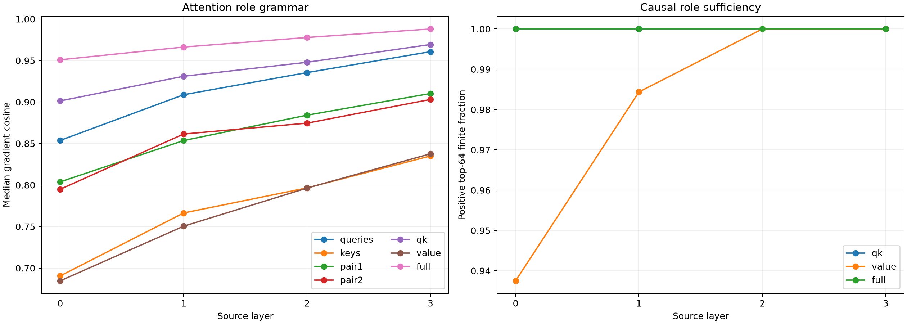

# Competent-feature attention-role selector

The validated next-eight attention window is split into the two bilinear QK factors and the current-value/OV path. Exact state-conditioned MLP Jacobians remain active throughout. Each role program prospectively selects its own top-64 native product channels on the same 64 held-out causal pairs.

Maximum local five-role recomposition error: `9.79e-08`.

## Locked hypotheses

- **Q0_role_factorization_recomposes_attention: supported.**
- **Q1_qk_routing_is_sufficient: supported.**
- **Q2_qk_retains_full_program_effect: supported.**
- **Q3_value_alone_is_insufficient: supported.**
- **Q4_queries_and_keys_are_complementary: not supported.**
- **Q5_two_tensor_factors_are_complementary: supported.**
- **Q6_qk_recovers_causal_support: supported.**

| Layer | Method | Gradient cosine | Support Jaccard | Leverage | Finite direction | Mean shift | Full-window ratio |
|---:|---|---:|---:|---:|---:|---:|---:|
| 0 | mlp_only | 0.657 | 0.306 | 0.605 | 0.922 | 0.1703 | 0.640 |
| 0 | near_queries | 0.854 | 0.471 | 0.854 | 1.000 | 0.2390 | 0.898 |
| 0 | near_keys | 0.691 | 0.326 | 0.651 | 0.922 | 0.1828 | 0.687 |
| 0 | near_pair1 | 0.804 | 0.407 | 0.774 | 0.984 | 0.2239 | 0.842 |
| 0 | near_pair2 | 0.795 | 0.407 | 0.793 | 1.000 | 0.2187 | 0.822 |
| 0 | near_qk | 0.901 | 0.542 | 0.899 | 1.000 | 0.2534 | 0.952 |
| 0 | near_value | 0.685 | 0.326 | 0.662 | 0.938 | 0.1771 | 0.666 |
| 0 | near_full | 0.951 | 0.652 | 0.948 | 1.000 | 0.2660 | 1.000 |
| 0 | all_full | 1.000 | 1.000 | 1.000 | 1.000 | 0.2852 | 1.072 |
| 1 | mlp_only | 0.732 | 0.340 | 0.718 | 0.984 | 0.2751 | 0.731 |
| 1 | near_queries | 0.909 | 0.580 | 0.906 | 1.000 | 0.3457 | 0.919 |
| 1 | near_keys | 0.766 | 0.376 | 0.749 | 0.984 | 0.2863 | 0.761 |
| 1 | near_pair1 | 0.854 | 0.471 | 0.835 | 1.000 | 0.3326 | 0.884 |
| 1 | near_pair2 | 0.861 | 0.471 | 0.845 | 1.000 | 0.3223 | 0.857 |
| 1 | near_qk | 0.931 | 0.600 | 0.922 | 1.000 | 0.3622 | 0.963 |
| 1 | near_value | 0.750 | 0.384 | 0.741 | 0.984 | 0.2829 | 0.752 |
| 1 | near_full | 0.966 | 0.707 | 0.967 | 1.000 | 0.3762 | 1.000 |
| 1 | all_full | 1.000 | 1.000 | 1.000 | 1.000 | 0.4028 | 1.071 |
| 2 | mlp_only | 0.775 | 0.391 | 0.763 | 1.000 | 0.2849 | 0.762 |
| 2 | near_queries | 0.935 | 0.600 | 0.933 | 1.000 | 0.3542 | 0.948 |
| 2 | near_keys | 0.797 | 0.422 | 0.805 | 1.000 | 0.2995 | 0.801 |
| 2 | near_pair1 | 0.884 | 0.506 | 0.878 | 1.000 | 0.3355 | 0.898 |
| 2 | near_pair2 | 0.875 | 0.524 | 0.879 | 1.000 | 0.3376 | 0.903 |
| 2 | near_qk | 0.948 | 0.662 | 0.946 | 1.000 | 0.3634 | 0.972 |
| 2 | near_value | 0.796 | 0.414 | 0.785 | 1.000 | 0.2984 | 0.798 |
| 2 | near_full | 0.978 | 0.742 | 0.976 | 1.000 | 0.3737 | 1.000 |
| 2 | all_full | 1.000 | 1.000 | 1.000 | 1.000 | 0.3895 | 1.042 |
| 3 | mlp_only | 0.820 | 0.422 | 0.809 | 1.000 | 0.3801 | 0.809 |
| 3 | near_queries | 0.961 | 0.695 | 0.965 | 1.000 | 0.4554 | 0.969 |
| 3 | near_keys | 0.835 | 0.430 | 0.825 | 1.000 | 0.3914 | 0.833 |
| 3 | near_pair1 | 0.910 | 0.542 | 0.905 | 1.000 | 0.4292 | 0.913 |
| 3 | near_pair2 | 0.903 | 0.552 | 0.913 | 1.000 | 0.4315 | 0.918 |
| 3 | near_qk | 0.969 | 0.718 | 0.970 | 1.000 | 0.4622 | 0.984 |
| 3 | near_value | 0.838 | 0.455 | 0.832 | 1.000 | 0.3894 | 0.829 |
| 3 | near_full | 0.988 | 0.816 | 0.988 | 1.000 | 0.4700 | 1.000 |
| 3 | all_full | 1.000 | 1.000 | 1.000 | 1.000 | 0.4789 | 1.019 |

## Guardrails

The five roles are exact derivative terms of this tensor-attention architecture, not learned semantic labels. Sufficiency of QK routing would identify a reusable computational verb for same-position selection; it would not imply that a feature is stored in queries or keys. Cross-position edits remain governed by the separate key/value transport result.
