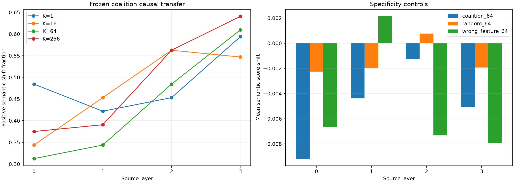

# Competent-feature causal transfer

Discovery-frozen activation-gap coalitions are estimated on 512 FineWeb rows, then tested on 64 disjoint same-position positive-donor/negative-recipient pairs spanning 32 competent token properties. Product channels are patched and the complete nonlinear suffix is recomputed.

## Locked hypotheses

- **C0_feature_coverage: supported.**
- **C1_frozen_coalitions_transfer: not supported.**
- **C2_frozen_coalitions_beat_random_channels: not supported.**
- **C3_feature_specific_channels_matter: not supported.**
- **C4_effect_is_semantically_specific: not supported.**
- **C5_layer3_is_not_less_causal: supported.**

## Post-hoc weight-aware red team

A discovery-only selector ranks channels by the product of the positive-minus-negative mean activation change and the mean exact semantic suffix gradient on four disjoint negative contexts per feature. A stricter covariance-aware variant instead ranks the mean per-pair product `E[delta * gradient]`. An endpoint-informed oracle ranks the exact held-out `delta * gradient` and is a positive control for the intervention pipeline.

| Layer | Coalition-64 direction/mean | Pair-contribution-64 direction/mean | Pair-contribution-256 direction/mean | Endpoint-oracle-64 direction/mean | Endpoint-oracle-256 direction/mean | Full mean |
|---:|---:|---:|---:|---:|---:|---:|
| 0 | 0.312/-0.0092 | 0.469/-0.0044 | 0.312/-0.0080 | 1.000/0.2852 | 1.000/0.5483 | 0.1282 |
| 1 | 0.344/-0.0044 | 0.500/-0.0023 | 0.438/-0.0096 | 1.000/0.4028 | 1.000/0.8195 | 0.8838 |
| 2 | 0.484/-0.0012 | 0.484/-0.0027 | 0.422/-0.0083 | 1.000/0.3895 | 1.000/0.8347 | 0.0294 |
| 3 | 0.609/-0.0051 | 0.500/0.0017 | 0.359/-0.0033 | 1.000/0.4789 | 1.000/1.0271 | 0.0563 |

### Coalition identity overlap

| Layer | Same-feature oracle Jaccard | Different-feature oracle Jaccard | Ratio | Oracle/frozen | Oracle/discovery-pair |
|---:|---:|---:|---:|---:|---:|
| 0 | 0.0156 | 0.0117 | 1.33 | 0.0206 | 0.0132 |
| 1 | 0.0176 | 0.0111 | 1.59 | 0.0189 | 0.0106 |
| 2 | 0.0154 | 0.0101 | 1.52 | 0.0184 | 0.0079 |
| 3 | 0.0144 | 0.0093 | 1.55 | 0.0171 | 0.0100 |

### Finite-scale red team

| Layer | Weight-aware 0.1 direction/mean | 0.25 | 0.5 | 1.0 |
|---:|---:|---:|---:|---:|
| 0 | 0.375/-0.0009 | 0.391/-0.0023 | 0.375/-0.0043 | 0.375/-0.0086 |
| 1 | 0.391/-0.0003 | 0.391/-0.0008 | 0.359/-0.0017 | 0.359/-0.0037 |
| 2 | 0.484/-0.0009 | 0.484/-0.0022 | 0.484/-0.0047 | 0.484/-0.0104 |
| 3 | 0.594/-0.0002 | 0.594/-0.0005 | 0.594/-0.0012 | 0.594/-0.0029 |

## Guardrails

### Worked examples at Layer 1

- **Numeric.** Replacing the product state from a context predicting `be` with
  one predicting `77` gives a +0.099 semantic shift using the endpoint top 64,
  versus +0.007 for the frozen numeric coalition. A second pair (`each` to
  `960`) gives +0.098 versus +0.004. The two successful coalitions share four
  channels.
- **Suffix `-ing`.** A pair contrasting `pher` with `keeping` gives +0.538 for
  the endpoint coalition versus +0.055 frozen. A second contrast (`le` versus
  `being`) gives +0.664 versus -0.013. The endpoint coalitions share two
  channels.
- **Pronoun.** Two held-out pairs give endpoint shifts +0.374 and +0.516,
  versus frozen shifts +0.036 and -0.002; their endpoint coalitions share five
  channels.

These examples should not be read as clean token substitutions—the surrounding
FineWeb contexts differ. They show causal transfer of product-channel values
between same-position natural contexts, with the full nonlinear suffix
recomputed.

The two pairs per feature are an initial causal screen, not a final per-feature estimate. Pair selection requires the model's feature score to be higher for the positive donor than the negative recipient and includes one extreme and one seeded non-extreme position. Coalitions are frozen from a disjoint discovery split and never selected using intervention effects. Because features overlap, the next-feature coalition is an imperfect wrong-feature control; random channels and the Gram-matched output contrast provide complementary baselines. Scaled patches distinguish failure of a local direction from nonlinear failure at the full donor magnitude.
