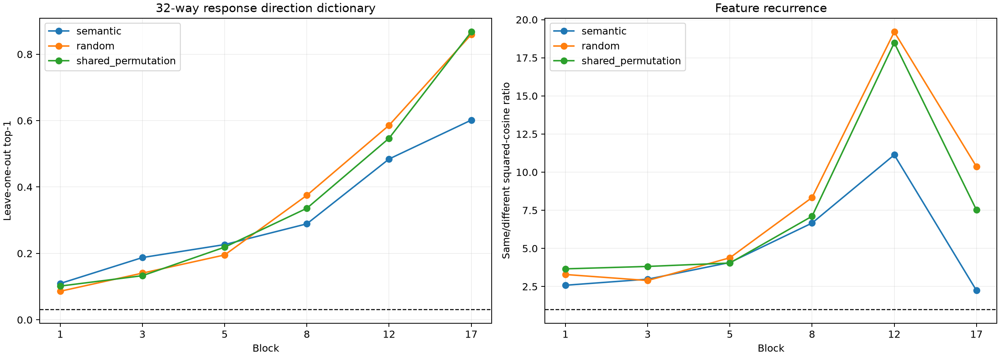

# Competent-feature direction dictionary

This held-out audit uses 32 of 50 predeclared token properties that passed the prior model-competence gate, with four FineWeb contexts per feature. Each semantic output contrast is compared with a vocabulary-permuted random contrast having the same positive/negative mass.

## Locked hypotheses

- **D0_feature_coverage: supported.**
- **D1_late_semantic_dictionary: supported.**
- **D2_semantics_beat_random_objectives: not supported.**
- **D3_semantic_recurrence_beats_random: not supported.**
- **D4_late_directions_are_cleaner: supported.**
- **D5_input_conditioning_remains: supported.**

## Post-hoc Gram-matched red team

A single shared vocabulary permutation preserves the complete 32-objective Gram matrix to relative error `1.90e-06` while breaking the association between labels and token identities.

| Block | Semantic response top1/top5 | Independent/shared-permutation top1 | Semantic response recurrence | Independent/shared-permutation recurrence | Semantic incoming top1 |
|---:|---:|---:|---:|---:|---:|
| 1 | 0.109/0.336 | 0.086/0.102 | 2.58 | 3.29/3.66 | 0.172 |
| 3 | 0.188/0.406 | 0.141/0.133 | 2.98 | 2.89/3.82 | 0.375 |
| 5 | 0.227/0.453 | 0.195/0.219 | 4.08 | 4.38/4.04 | 0.625 |
| 8 | 0.289/0.508 | 0.375/0.336 | 6.66 | 8.34/7.11 | 0.828 |
| 12 | 0.484/0.719 | 0.586/0.547 | 11.13 | 19.20/18.48 | 0.930 |
| 17 | 0.602/0.773 | 0.859/0.867 | 2.24 | 10.36/7.52 | 1.000 |

## Guardrails

The labels overlap semantically and lexically, so 32-way top-1 accuracy is deliberately strict. The independent random-objective control preserves each contrast's balance but not inter-feature overlap. The shared-permutation control preserves both. Site selection and the two null generators use separate deterministic streams, so adding a null cannot change the evaluation sites. One draw of each null is still insufficient for a precise null distribution. These are output-defined supervised features, not a claim about the model's complete native ontology.
