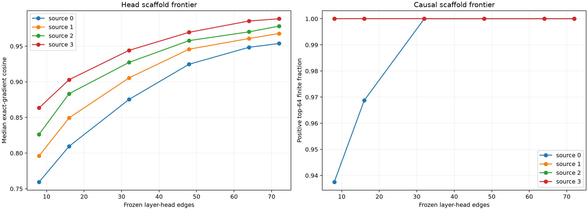

# Competent-feature layer-head scaffold

Four disjoint eight-feature discovery panels rank the 72 layer-head edges in each source layer's successful next-eight attention window. Their averaged frozen ordering is evaluated on one disjoint uniform pair for every one of the 32 competent features, with matched random edge programs. The locked stability hypothesis still refers to panels A and B; the four-panel aggregation is a post-hoc sampling-noise red team.

Maximum local nine-head recomposition error: `1.12e-06`.

## Locked hypotheses

- **H0_head_decomposition_is_exact: supported.**
- **H1_discovery_rankings_are_stable: not supported.**
- **H2_top32_is_high_fidelity: not supported.**
- **H3_top32_is_causally_directional: supported.**
- **H4_top32_retains_near8_effect: supported.**
- **H5_top16_is_not_universally_sufficient: supported.**
- **H6_top32_beats_random: not supported.**

| Source | Discovery correlation | Top32 Jaccard | Top16 cosine/direction | Top32 cosine/direction/effect | Random32 p95 |
|---:|---:|---:|---:|---:|---:|
| 0 | 0.313 | 0.362 | 0.809/0.969 | 0.875/1.000/0.886 | 0.822 |
| 1 | 0.243 | 0.391 | 0.849/1.000 | 0.906/1.000/0.910 | 0.868 |
| 2 | 0.218 | 0.524 | 0.883/1.000 | 0.927/1.000/0.947 | 0.891 |
| 3 | 0.201 | 0.524 | 0.903/1.000 | 0.944/1.000/0.947 | 0.916 |

## Post-hoc four-panel stability

| Source | Pairwise correlation median/min | Top32 Jaccard median/min |
|---:|---:|---:|
| 0 | 0.419/0.257 | 0.377/0.306 |
| 1 | 0.305/0.243 | 0.488/0.362 |
| 2 | 0.466/0.193 | 0.561/0.488 |
| 3 | 0.437/0.201 | 0.542/0.488 |

## Top eight frozen edges by source

- Source 0: B1/H1, B8/H3, B1/H8, B1/H3, B2/H5, B1/H4, B4/H0, B2/H6
- Source 1: B8/H3, B2/H6, B2/H3, B9/H7, B2/H5, B2/H2, B3/H0, B4/H0
- Source 2: B8/H3, B3/H0, B3/H6, B3/H5, B9/H7, B4/H0, B4/H5, B6/H1
- Source 3: B8/H3, B4/H5, B4/H0, B11/H6, B5/H8, B6/H1, B4/H1, B5/H7

## Guardrails

The scaffold is discovery-frozen but source-layer specific. Head VJPs remain state-conditioned, and edge sparsity does not imply a head has one semantic meaning. Leave-one-out scores can underestimate redundant or synergistic heads; the independent-panel stability and random-program controls test, but do not eliminate, that ambiguity.
