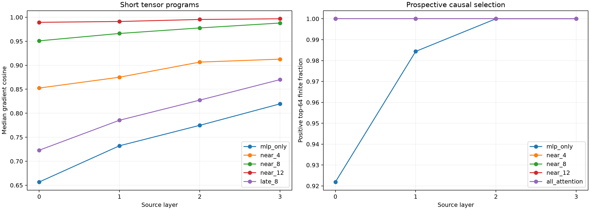

# Competent-feature prospective tensor selector

The exact recipient-specific selector is compressed by retaining native state-conditioned MLP Jacobians throughout the suffix while enabling exact attention Jacobians only in a short window after each source layer. All 32 competent features and the same 64 held-out causal pairs are used; each approximate gradient selects its own top-64 product channels before a finite suffix recomputation.

Maximum all-attention recurrence error against independent autograd checks: `1.36e-06`.

## Locked hypotheses

- **P0_exact_composition_matches_autograd: supported.**
- **P1_near8_gradient_fidelity: supported.**
- **P2_near8_causal_direction: supported.**
- **P3_near8_retains_oracle_effect: supported.**
- **P4_near4_is_insufficient: supported.**
- **P5_near_attention_beats_late_attention: supported.**
- **P6_mlp_only_is_insufficient: supported.**
- **P7_near8_recovers_oracle_support: supported.**

| Layer | Method | Gradient cosine | Top-64 Jaccard | Leverage | Finite direction | Mean shift | Oracle-effect ratio |
|---:|---|---:|---:|---:|---:|---:|---:|
| 0 | mlp_only | 0.657 | 0.306 | 0.605 | 0.922 | 0.1703 | 0.597 |
| 0 | near_2 | 0.783 | 0.399 | 0.776 | 0.953 | 0.2068 | 0.725 |
| 0 | near_4 | 0.852 | 0.471 | 0.845 | 1.000 | 0.2302 | 0.807 |
| 0 | near_8 | 0.951 | 0.652 | 0.948 | 1.000 | 0.2660 | 0.933 |
| 0 | near_12 | 0.989 | 0.829 | 0.990 | 1.000 | 0.2808 | 0.985 |
| 0 | late_8 | 0.723 | 0.333 | 0.655 | 0.984 | 0.1907 | 0.669 |
| 0 | all_attention | 1.000 | 1.000 | 1.000 | 1.000 | 0.2852 | 1.000 |
| 1 | mlp_only | 0.732 | 0.340 | 0.718 | 0.984 | 0.2751 | 0.683 |
| 1 | near_2 | 0.822 | 0.430 | 0.784 | 1.000 | 0.3012 | 0.748 |
| 1 | near_4 | 0.875 | 0.471 | 0.864 | 1.000 | 0.3279 | 0.814 |
| 1 | near_8 | 0.966 | 0.707 | 0.967 | 1.000 | 0.3762 | 0.934 |
| 1 | near_12 | 0.991 | 0.829 | 0.991 | 1.000 | 0.4074 | 1.011 |
| 1 | late_8 | 0.785 | 0.391 | 0.789 | 1.000 | 0.3068 | 0.762 |
| 1 | all_attention | 1.000 | 1.000 | 1.000 | 1.000 | 0.4028 | 1.000 |
| 2 | mlp_only | 0.775 | 0.391 | 0.763 | 1.000 | 0.2849 | 0.731 |
| 2 | near_2 | 0.858 | 0.488 | 0.863 | 1.000 | 0.3170 | 0.814 |
| 2 | near_4 | 0.907 | 0.524 | 0.903 | 1.000 | 0.3412 | 0.876 |
| 2 | near_8 | 0.978 | 0.742 | 0.976 | 1.000 | 0.3737 | 0.960 |
| 2 | near_12 | 0.995 | 0.869 | 0.994 | 1.000 | 0.3871 | 0.994 |
| 2 | late_8 | 0.827 | 0.414 | 0.827 | 1.000 | 0.3148 | 0.808 |
| 2 | all_attention | 1.000 | 1.000 | 1.000 | 1.000 | 0.3895 | 1.000 |
| 3 | mlp_only | 0.820 | 0.422 | 0.809 | 1.000 | 0.3801 | 0.794 |
| 3 | near_2 | 0.878 | 0.488 | 0.862 | 1.000 | 0.4096 | 0.855 |
| 3 | near_4 | 0.913 | 0.561 | 0.904 | 1.000 | 0.4310 | 0.900 |
| 3 | near_8 | 0.988 | 0.816 | 0.988 | 1.000 | 0.4700 | 0.981 |
| 3 | near_12 | 0.997 | 0.896 | 0.996 | 1.000 | 0.4772 | 0.996 |
| 3 | late_8 | 0.870 | 0.497 | 0.866 | 1.000 | 0.4077 | 0.851 |
| 3 | all_attention | 1.000 | 1.000 | 1.000 | 1.000 | 0.4789 | 1.000 |

## Post-hoc minimum near-source window

A width passes only if median gradient cosine is at least 0.90, Q10 at least 0.80, top-64 Jaccard at least 0.50, finite direction at least 0.95, and mean finite effect at least 0.90 of the exact selector.

| Source layer | Minimum tested width |
|---:|---:|
| 0 | 8 |
| 1 | 8 |
| 2 | 6 |
| 3 | 5 |

## Guardrails

This is prospective with respect to channel selection but still conditions on the declared semantic objective, donor activation change, and recipient forward states. It is a compressed executable explanation, not an unsupervised ontology detector. Every MLP Jacobian remains exact; the compression tested here concerns how many attention Jacobians must be evaluated. The all-attention program is mathematically the exact local gradient and serves as the endpoint upper control.
