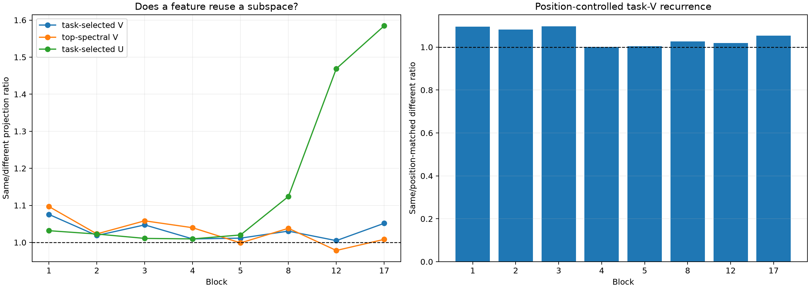

# Dynamic MLP feature-subspace recurrence

This audit uses 32 held-out sites: two extreme and two uniform examples for each of eight supervised token features. At each sampled suffix block it asks whether a target response lies preferentially in task-selected singular subspaces discovered on other examples of the same feature.

## Locked hypotheses

- **R0_same_feature_task_subspaces_recur: not supported.**
- **R1_recurrence_is_not_only_state_spectrum: not supported.**
- **R2_output_role_recurrence: not supported.**
- **R3_recurrence_survives_position_control: supported.**
- **R4_feature_labels_beat_permutation: not supported.**

| Block | Task V same/different | Task V same/position-control | Task V p | Spectral V same/different | Task U same/different | Direct response/incoming similarity ratio |
|---:|---:|---:|---:|---:|---:|---:|
| 1 | 1.08 | 1.10 | 0.008 | 1.10 | 1.03 | 1.38/0.76 |
| 2 | 1.02 | 1.08 | 0.188 | 1.02 | 1.02 | 0.71/1.12 |
| 3 | 1.05 | 1.10 | 0.028 | 1.06 | 1.01 | 0.87/1.22 |
| 4 | 1.01 | 1.00 | 0.295 | 1.04 | 1.01 | 1.02/1.78 |
| 5 | 1.01 | 1.00 | 0.265 | 1.00 | 1.02 | 0.75/3.13 |
| 8 | 1.03 | 1.03 | 0.078 | 1.04 | 1.12 | 1.24/7.94 |
| 12 | 1.00 | 1.02 | 0.379 | 0.98 | 1.47 | 2.28/14.02 |
| 17 | 1.05 | 1.05 | 0.002 | 1.01 | 1.58 | 2.85/12.45 |

## Interpretation guardrails

The eight labels are deliberately simple supervised probes, not a complete ontology. A positive recurrence result would show a reusable subspace for these output effects, not prove that it is the model's only or preferred feature basis. A null result can mean that the feature is implemented by context-conditioned coalitions. The nearest-position control matches absolute position only; it does not match the full lexical or syntactic context. Task-selected modes are chosen using the target semantic adjoint and therefore diagnose output-conditioned computation rather than an unsupervised basis. Direct squared-cosine recurrence of the incoming adjoints and local responses is reported as a post-hoc control: if it already explains the task-U separation, the latter should be read as an output-objective effect rather than a newly discovered latent ontology.
