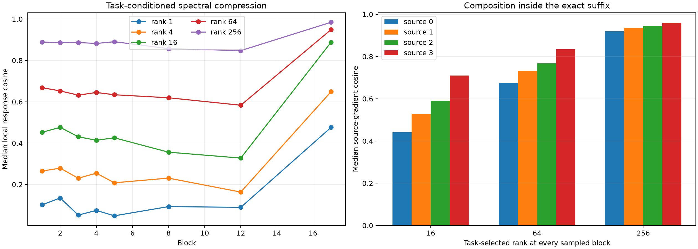

# Dynamic bilinear MLP Jacobian spectrum

For eight held-out semantic sites, analytic state-conditioned MLP Jacobians are constructed directly from the bilinear weights and RMSNorm derivative at eight suffix blocks. Their singular modes are assessed by matrix energy, actual semantic-adjoint energy, cross-context recurrence, a channel-coefficient permutation null, and finite interventions after reinsertion into the exact suffix recurrence.

Maximum analytic-versus-autograd VJP error: `1.75e-06`.

## Locked hypotheses

- **M0_analytic_jacobian_matches_autograd: supported.**
- **M1_rank64_captures_local_task_response: not supported.**
- **M2_rank256_nearly_completes_local_task_response: not supported.**
- **M3_task_response_is_mode_sparse: not supported.**
- **M4_top_subspaces_recur_across_contexts: not supported.**
- **M5_leading_singular_values_exceed_permutation_null: not supported.**
- **M6_rank64_composes_causally: not supported.**
- **M7_rank16_is_not_universally_sufficient: supported.**

| Block | Effective rank | Spectral K90 | Task-prefix K90 | Task-optimal K90 | Rank64 spectral/task-selected | Rank256 spectral/task-selected | U/V overlap | Lead/null |
|---:|---:|---:|---:|---:|---:|---:|---:|---:|
| 1 | 530.9 | 482 | 404 | 236 | 0.668/0.797 | 0.889/0.956 | 0.146/0.048 | 1.35 |
| 2 | 517.4 | 475 | 406 | 238 | 0.653/0.795 | 0.886/0.955 | 0.168/0.054 | 1.37 |
| 3 | 506.2 | 465 | 408 | 239 | 0.632/0.776 | 0.887/0.954 | 0.197/0.066 | 1.29 |
| 4 | 503.0 | 464 | 414 | 239 | 0.645/0.794 | 0.882/0.954 | 0.192/0.074 | 1.29 |
| 5 | 443.8 | 454 | 398 | 230 | 0.634/0.801 | 0.891/0.958 | 0.225/0.097 | 2.00 |
| 8 | 534.6 | 482 | 464 | 264 | 0.620/0.758 | 0.857/0.946 | 0.175/0.070 | 1.16 |
| 12 | 562.3 | 497 | 464 | 273 | 0.583/0.760 | 0.848/0.943 | 0.104/0.056 | 1.28 |
| 17 | 68.8 | 312 | 56 | 36 | 0.949/0.967 | 0.985/0.993 | 0.414/0.319 | 4.58 |

| Program | Gradient cosine | Contribution cosine | Leverage | Finite direction |
|---|---:|---:|---:|---:|
| Source 0, all sampled blocks rank 16 | 0.366 | 0.363 | 0.433 | 0.625 |
| Source 0, task-selected rank 16 | 0.442 | 0.440 | 0.453 | 0.750 |
| Source 0, all sampled blocks rank 64 | 0.509 | 0.569 | 0.627 | 1.000 |
| Source 0, task-selected rank 64 | 0.674 | 0.679 | 0.655 | 1.000 |
| Source 0, all sampled blocks rank 256 | 0.814 | 0.831 | 0.865 | 1.000 |
| Source 0, task-selected rank 256 | 0.919 | 0.932 | 0.933 | 1.000 |
| Source 1, all sampled blocks rank 16 | 0.417 | 0.498 | 0.523 | 0.875 |
| Source 1, task-selected rank 16 | 0.527 | 0.560 | 0.609 | 1.000 |
| Source 1, all sampled blocks rank 64 | 0.600 | 0.588 | 0.624 | 1.000 |
| Source 1, task-selected rank 64 | 0.732 | 0.752 | 0.760 | 1.000 |
| Source 1, all sampled blocks rank 256 | 0.855 | 0.882 | 0.885 | 1.000 |
| Source 1, task-selected rank 256 | 0.935 | 0.940 | 0.945 | 1.000 |
| Source 2, all sampled blocks rank 16 | 0.490 | 0.448 | 0.476 | 1.000 |
| Source 2, task-selected rank 16 | 0.591 | 0.631 | 0.639 | 1.000 |
| Source 2, all sampled blocks rank 64 | 0.641 | 0.663 | 0.695 | 1.000 |
| Source 2, task-selected rank 64 | 0.767 | 0.789 | 0.813 | 1.000 |
| Source 2, all sampled blocks rank 256 | 0.873 | 0.885 | 0.892 | 1.000 |
| Source 2, task-selected rank 256 | 0.944 | 0.948 | 0.955 | 1.000 |
| Source 3, all sampled blocks rank 16 | 0.620 | 0.636 | 0.655 | 1.000 |
| Source 3, task-selected rank 16 | 0.710 | 0.727 | 0.781 | 1.000 |
| Source 3, all sampled blocks rank 64 | 0.730 | 0.743 | 0.788 | 1.000 |
| Source 3, task-selected rank 64 | 0.835 | 0.844 | 0.860 | 1.000 |
| Source 3, all sampled blocks rank 256 | 0.914 | 0.920 | 0.938 | 1.000 |
| Source 3, task-selected rank 256 | 0.960 | 0.961 | 0.953 | 1.000 |

## Guardrails

Singular modes are computed for the current sequence position. Other positions retain exact MLP VJPs in the causal recurrence, and unsampled suffix blocks remain exact. Therefore the simultaneous truncation result is a targeted test of the analyzed operators, not yet a complete low-rank replacement of every position and block. The permutation null preserves coefficient marginals but changes which native channel receives each coefficient; it is not a full random-matrix null for the learned weights. Task-selected modes are an explicitly post-hoc, output-conditioned red-team: they measure compressibility of one backward computation, not a reusable context-independent feature basis.
