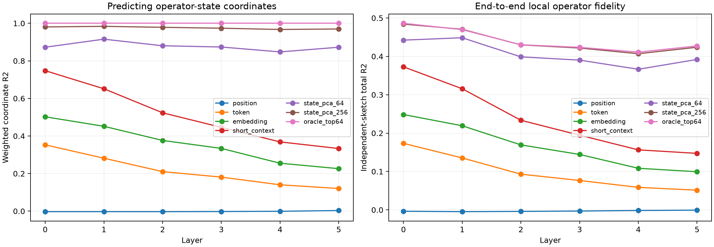

# Early operator-state context router

The converged top-64 operator subspace is frozen at each layer. Routers predict its whitened state coefficients from exact current-token lookup, position, a 128D current embedding projection, the current plus previous-token and previous-eight-token embedding summary, or 64/256 natural-state coordinates. Ridge penalties are selected on held-out discovery rows. Evaluation uses disjoint FineWeb and an independent weight-derived operator sketch.

## Locked hypotheses

- **R0_current_token_routes_operator_state: not supported.**
- **R1_embedding_geometry_generalizes_router: supported.**
- **R2_short_context_improves_routing: supported.**
- **R3_contextual_routing_strengthens_with_depth: not supported.**
- **R4_state64_is_a_compact_router: supported.**
- **R5_short_context_recovers_half_oracle_operator_gain: not supported.**
- **R6_position_is_not_the_primary_router: supported.**

Each cell is weighted coordinate R2 / total operator R2. Total R2 includes the rank-64 truncation ceiling.

| Layer | Mean | Position | Token (coverage) | Embedding | Short context | State64 | State256 | Oracle64 |
|---:|---:|---:|---:|---:|---:|---:|---:|---:|
| 0 | 0.000/-0.002 | -0.003/-0.004 | 0.353/0.173 (0.62) | 0.502/0.248 | 0.748/0.373 | 0.873/0.442 | 0.981/0.484 | 1.000/0.486 |
| 1 | 0.000/-0.003 | -0.003/-0.005 | 0.282/0.135 (0.62) | 0.452/0.219 | 0.651/0.316 | 0.915/0.448 | 0.984/0.471 | 1.000/0.470 |
| 2 | 0.000/-0.003 | -0.003/-0.004 | 0.210/0.093 (0.62) | 0.376/0.169 | 0.524/0.233 | 0.880/0.399 | 0.979/0.430 | 1.000/0.430 |
| 3 | 0.000/-0.002 | -0.002/-0.003 | 0.181/0.077 (0.62) | 0.334/0.144 | 0.446/0.195 | 0.874/0.390 | 0.974/0.422 | 1.000/0.424 |
| 4 | 0.000/-0.002 | -0.001/-0.002 | 0.140/0.059 (0.62) | 0.255/0.108 | 0.369/0.156 | 0.848/0.366 | 0.967/0.407 | 1.000/0.411 |
| 5 | 0.000/-0.002 | 0.003/-0.001 | 0.120/0.051 (0.62) | 0.226/0.099 | 0.333/0.147 | 0.873/0.392 | 0.970/0.424 | 1.000/0.427 |

Short-context minus current-embedding weighted R2 by layer: `{"0": 0.24547231197357178, "1": 0.19974768161773682, "2": 0.14721310138702393, "3": 0.1121324896812439, "4": 0.1134873628616333, "5": 0.10717839002609253}`.

## Guardrails

The embedding features are projected into each layer's first 128 natural-state directions, so failure can reflect an insufficient lexical feature budget rather than absence of lexical routing. Conversely, state-PCA routers directly observe the hidden state and are compression ceilings, not prospective input-only explanations. Total operator R2 is measured with a fresh random tensor sketch and cannot exceed the frozen rank-64 oracle ceiling.
