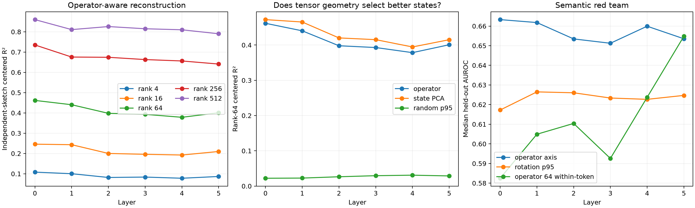

# Weight-derived early operator-tensor vocabulary

For each bilinear MLP, random Kronecker probes sketch the exact linear map from the current normalized state to the complete local MLP Jacobian. Natural-state covariance whitens the state coordinates; an SVD then supplies a label-free operator-aware basis. A second independent weight sketch and disjoint FineWeb states evaluate reconstruction. State PCA, random whitened subspaces, and rotations within the same operator subspace are controls.

Maximum explicit-versus-implicit tensor identity error: `3.77e-05`.

## Locked hypotheses

- **O0_probe_replication_identifies_operator_modes: not supported.**
- **O1_rank64_operator_vocabulary_is_predictive: not supported.**
- **O2_operator_basis_beats_state_pca: not supported.**
- **O3_rank256_is_high_fidelity: not supported.**
- **O4_operator_axes_are_semantically_privileged: supported.**
- **O5_operator_subspace_improves_context_semantics: not supported.**
- **O6_operator_directions_recur_across_depth: supported.**

| Layer | Probe overlap | Eff. rank | Top64 energy | R2 op64 / PCA64 / random p95 | R2 op256 | Semantic one / rotation p95 | Within-token op/PCA |
|---:|---:|---:|---:|---:|---:|---:|---:|
| 0 | 0.681 | 114.7 | 0.569 | 0.462 / 0.472 / 0.022 | 0.735 | 0.663 / 0.617 | 0.582/0.564 |
| 1 | 0.673 | 113.0 | 0.556 | 0.440 / 0.465 / 0.023 | 0.675 | 0.662 / 0.626 | 0.605/0.601 |
| 2 | 0.659 | 137.0 | 0.531 | 0.398 / 0.420 / 0.026 | 0.674 | 0.653 / 0.626 | 0.610/0.621 |
| 3 | 0.646 | 139.9 | 0.522 | 0.393 / 0.415 / 0.029 | 0.663 | 0.651 / 0.623 | 0.593/0.611 |
| 4 | 0.629 | 153.0 | 0.509 | 0.378 / 0.395 / 0.031 | 0.656 | 0.660 / 0.623 | 0.624/0.596 |
| 5 | 0.657 | 131.7 | 0.532 | 0.401 / 0.415 / 0.029 | 0.641 | 0.654 / 0.625 | 0.655/0.664 |

Adjacent-layer overlap of the decoded top-64 state-direction subspaces: `{"0-1": 0.36898037791252136, "1-2": 0.45472288131713867, "2-3": 0.5070531368255615, "3-4": 0.5017566680908203, "4-5": 0.5186182260513306}`.

## Interpretation boundary

These modes are canonical for Frobenius prediction of the local MLP Jacobian under the measured FineWeb state covariance. They are not automatically semantic concepts or complete transformer circuits. Kronecker sketches are unbiased but finite; the independent-sketch overlap and reconstruction columns expose sketch error. A positive operator reconstruction result still requires suffix composition and finite causal validation before it becomes a circuit explanation.
