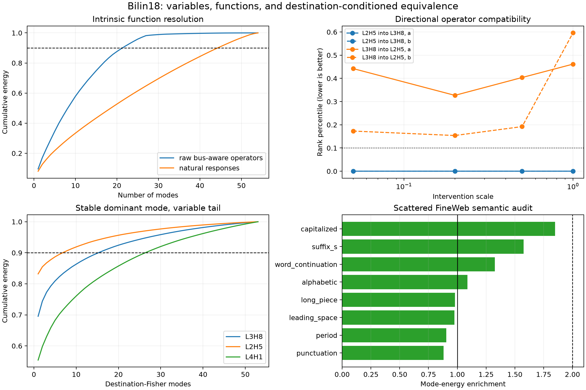

# Function ontology summary

The panels separate four questions that should not share one monosemanticity score:

1. Raw bus-aware operators have moderate linear compression (rank 22 for 90%), while natural head responses remain broad (rank 45).
2. Full-operator replacement is directional: L2H5 is uniquely compatible with later target L3H8 at every scale, while the reverse is ordinary.
3. Destination-Fisher spaces always have one dominant sensitivity direction, but the 90% tail varies substantially by target (5–27 modes).
4. The dominant L3H8 mode transfers to scattered FineWeb, but known token labels are only modestly enriched; it remains mechanistically clear and semantically unresolved.

The visual is descriptive; exact gates, controls, and caveats remain in the linked experiment reports.
