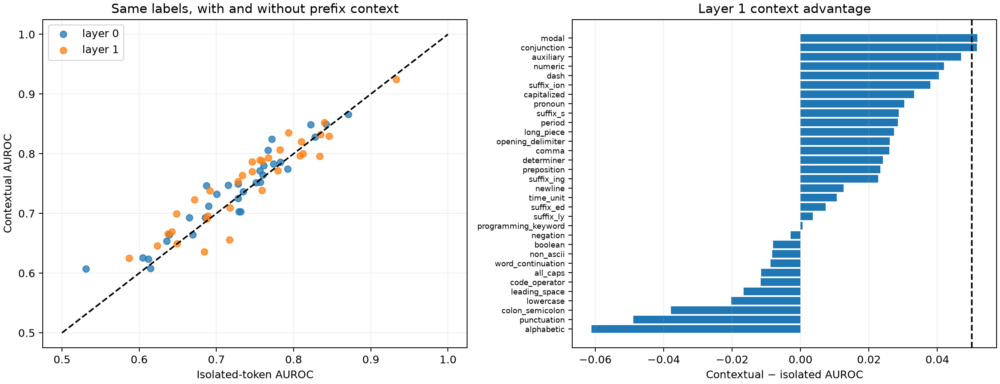

# Context ablation for the supervised layer-0/1 census

The supervised census is rerun on the identical FineWeb sites. The red-team baseline sees only the current token: every distinct token is forwarded as a one-token sequence, and a separate fixed native-channel coalition is fitted to predict the same next-token labels. This is stronger than a finite-data unigram lookup because morphologically related tokens can share the model's isolated-token code.

## Locked hypotheses

- **C0_context_beats_isolated_token_code: not supported.**
- **C1_context_matters_for_many_features: not supported.**
- **C2_layer1_adds_more_context_than_layer0: not supported.**
- **C3_contextual_result_is_not_unigram_memorization: supported.**
- **C4_same_examples_and_labels: supported.**

Competent labels: **32**; unique current tokens: **8,476**; median unigram AUROC: **0.731**.

| Layer | Contextual 64 | Isolated-token 64 | Median context gain | Fraction gain ≥ .05 |
|---:|---:|---:|---:|---:|
| 0 | 0.747 | 0.730 | 0.011 | 9.4% |
| 1 | 0.767 | 0.746 | 0.018 | 6.2% |

| Feature | Unigram | L0 context / isolated / gain | L1 context / isolated / gain |
|---|---:|---:|---:|
| modal | 0.707 | 0.747/0.687/+0.059 | 0.723/0.671/+0.052 |
| conjunction | 0.690 | 0.626/0.605/+0.021 | 0.700/0.648/+0.052 |
| auxiliary | 0.754 | 0.732/0.701/+0.032 | 0.738/0.691/+0.047 |
| numeric | 0.726 | 0.806/0.767/+0.040 | 0.835/0.793/+0.042 |
| dash | 0.750 | 0.747/0.715/+0.032 | 0.787/0.746/+0.040 |
| suffix_ion | 0.612 | 0.607/0.531/+0.076 | 0.625/0.587/+0.038 |
| capitalized | 0.763 | 0.693/0.665/+0.028 | 0.789/0.756/+0.033 |
| pronoun | 0.748 | 0.749/0.728/+0.022 | 0.764/0.734/+0.030 |
| suffix_s | 0.631 | 0.664/0.639/+0.025 | 0.666/0.637/+0.029 |
| period | 0.749 | 0.772/0.757/+0.015 | 0.788/0.759/+0.028 |
| long_piece | 0.639 | 0.624/0.612/+0.012 | 0.669/0.642/+0.027 |
| opening_delimiter | 0.665 | 0.703/0.729/-0.026 | 0.754/0.728/+0.026 |
| comma | 0.741 | 0.765/0.760/+0.004 | 0.793/0.767/+0.026 |
| determiner | 0.763 | 0.752/0.751/+0.000 | 0.807/0.782/+0.024 |
| preposition | 0.736 | 0.752/0.757/-0.005 | 0.770/0.747/+0.023 |
| suffix_ing | 0.646 | 0.608/0.614/-0.006 | 0.646/0.623/+0.023 |
| newline | 0.871 | 0.866/0.871/-0.005 | 0.852/0.840/+0.013 |
| time_unit | 0.688 | 0.825/0.772/+0.053 | 0.820/0.810/+0.011 |
| suffix_ed | 0.708 | 0.712/0.690/+0.023 | 0.696/0.689/+0.007 |
| suffix_ly | 0.583 | 0.664/0.669/-0.005 | 0.691/0.687/+0.004 |
| programming_keyword | 0.582 | 0.654/0.635/+0.018 | 0.650/0.649/+0.001 |
| negation | 0.699 | 0.849/0.822/+0.027 | 0.832/0.835/-0.003 |
| boolean | 0.633 | 0.703/0.731/-0.029 | 0.709/0.717/-0.008 |
| non_ascii | 0.832 | 0.780/0.761/+0.019 | 0.771/0.780/-0.008 |
| word_continuation | 0.896 | 0.850/0.842/+0.008 | 0.924/0.933/-0.009 |
| all_caps | 0.683 | 0.774/0.792/-0.018 | 0.801/0.812/-0.012 |
| code_operator | 0.752 | 0.786/0.783/+0.003 | 0.796/0.808/-0.012 |
| leading_space | 0.828 | 0.828/0.827/+0.001 | 0.829/0.846/-0.017 |
| lowercase | 0.749 | 0.693/0.685/+0.008 | 0.739/0.759/-0.020 |
| colon_semicolon | 0.720 | 0.783/0.774/+0.009 | 0.796/0.834/-0.038 |
| punctuation | 0.755 | 0.737/0.735/+0.002 | 0.636/0.684/-0.049 |
| alphabetic | 0.736 | 0.725/0.728/-0.002 | 0.656/0.717/-0.061 |
