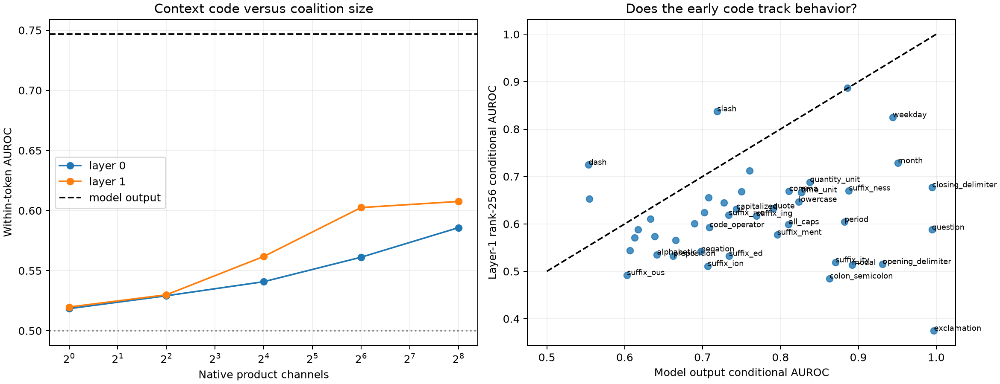

# Within-current-token supervised feature census

Every AUROC comparison is made only between held-out examples with the exact same current GPT-2 token but different next-token feature labels. The metric is a pair-weighted average across token identities. Any predictor that is a deterministic function of the current embedding alone—including an isolated-token forward pass—scores exactly 0.5 on these pairs.

## Locked hypotheses

- **T0_conditional_coverage: supported.**
- **T1_model_behavior_uses_context: supported.**
- **T2_layer1_coalitions_encode_context: supported.**
- **T3_layer1_approaches_model_behavior: not supported.**
- **T4_depth_improves_conditional_code: supported.**
- **T5_conditional_code_is_not_single_neuron_aligned: supported.**
- **T6_exact_token_matching_removes_embedding_only_explanations: supported.**

Eligible labels: **46**; conditionally competent labels: **44**; median model-output conditional AUROC: **0.747**.

| Feature | pairs/groups | Model | L0 one / 64 / 256 | L1 one / 64 / 256 |
|---|---:|---:|---:|---:|
| exclamation | 694/10 | 0.997 | 0.422/0.369/0.754 | 0.059/0.901/0.375 |
| closing_delimiter | 1,152/19 | 0.995 | 0.504/0.815/0.856 | 0.549/0.634/0.677 |
| question | 730/26 | 0.995 | 0.257/0.523/0.585 | 0.497/0.782/0.588 |
| month | 4,778/21 | 0.951 | 0.553/0.632/0.789 | 0.539/0.715/0.728 |
| weekday | 914/9 | 0.944 | 0.493/0.832/0.782 | 0.538/0.654/0.825 |
| opening_delimiter | 3,326/33 | 0.931 | 0.380/0.464/0.365 | 0.505/0.574/0.515 |
| modal | 13,520/64 | 0.892 | 0.456/0.548/0.565 | 0.591/0.569/0.513 |
| suffix_ness | 1,623/12 | 0.888 | 0.497/0.448/0.546 | 0.519/0.499/0.670 |
| numeric | 75,233/112 | 0.886 | 0.702/0.774/0.771 | 0.721/0.860/0.887 |
| period | 5,479/286 | 0.882 | 0.629/0.628/0.588 | 0.489/0.644/0.604 |
| suffix_ity | 5,945/27 | 0.871 | 0.652/0.363/0.364 | 0.408/0.610/0.519 |
| colon_semicolon | 920/44 | 0.863 | 0.458/0.480/0.501 | 0.428/0.412/0.485 |
| quantity_unit | 10,184/29 | 0.838 | 0.487/0.480/0.661 | 0.526/0.589/0.688 |
| time_unit | 10,183/46 | 0.827 | 0.604/0.704/0.709 | 0.523/0.671/0.667 |
| lowercase | 221,940/784 | 0.823 | 0.512/0.505/0.521 | 0.494/0.658/0.647 |
| comma | 3,848/276 | 0.811 | 0.452/0.493/0.494 | 0.623/0.636/0.669 |
| all_caps | 24,058/96 | 0.810 | 0.475/0.558/0.654 | 0.554/0.579/0.599 |
| suffix_ment | 4,260/15 | 0.796 | 0.744/0.642/0.570 | 0.654/0.539/0.577 |
| quote | 5,825/21 | 0.790 | 0.455/0.712/0.778 | 0.591/0.627/0.633 |
| suffix_ing | 39,474/135 | 0.769 | 0.510/0.517/0.540 | 0.475/0.593/0.617 |
| word_continuation | 40,248/200 | 0.760 | 0.504/0.469/0.480 | 0.493/0.672/0.712 |
| currency | 2,013/14 | 0.750 | 0.674/0.668/0.639 | 0.510/0.665/0.668 |
| capitalized | 279,391/318 | 0.743 | 0.542/0.530/0.545 | 0.473/0.610/0.632 |
| suffix_ed | 28,486/119 | 0.734 | 0.515/0.547/0.599 | 0.508/0.582/0.533 |
| suffix_ive | 5,741/17 | 0.733 | 0.597/0.548/0.577 | 0.698/0.629/0.618 |
| auxiliary | 52,459/234 | 0.728 | 0.548/0.582/0.611 | 0.586/0.639/0.645 |
| slash | 935/16 | 0.719 | 0.710/0.801/0.833 | 0.705/0.834/0.837 |
| code_operator | 17,700/117 | 0.709 | 0.671/0.627/0.465 | 0.626/0.639/0.593 |
| pronoun | 116,006/177 | 0.707 | 0.555/0.584/0.601 | 0.520/0.642/0.656 |
| suffix_ion | 21,016/88 | 0.707 | 0.506/0.603/0.647 | 0.460/0.488/0.511 |
| conjunction | 71,703/216 | 0.702 | 0.553/0.568/0.587 | 0.583/0.637/0.624 |
| negation | 7,590/41 | 0.698 | 0.516/0.648/0.727 | 0.489/0.554/0.542 |
| newline | 85,453/62 | 0.690 | 0.619/0.609/0.594 | 0.575/0.595/0.600 |
| suffix_s | 90,489/343 | 0.665 | 0.466/0.558/0.536 | 0.497/0.547/0.566 |
| preposition | 66,534/485 | 0.662 | 0.553/0.600/0.578 | 0.476/0.502/0.533 |
| alphabetic | 191,947/703 | 0.641 | 0.521/0.519/0.535 | 0.593/0.530/0.535 |
| determiner | 170,421/294 | 0.639 | 0.502/0.523/0.546 | 0.525/0.575/0.574 |
| programming_keyword | 43,206/164 | 0.633 | 0.529/0.567/0.589 | 0.438/0.562/0.611 |
| suffix_ly | 17,879/81 | 0.617 | 0.567/0.564/0.524 | 0.482/0.519/0.588 |
| long_piece | 167,458/387 | 0.613 | 0.534/0.523/0.529 | 0.513/0.543/0.571 |
| leading_space | 130,441/670 | 0.607 | 0.508/0.468/0.484 | 0.475/0.564/0.544 |
| suffix_ous | 1,831/10 | 0.603 | 0.573/0.406/0.448 | 0.667/0.538/0.492 |
| non_ascii | 26,055/75 | 0.554 | 0.422/0.660/0.674 | 0.571/0.533/0.653 |
| dash | 6,601/89 | 0.554 | 0.574/0.616/0.640 | 0.460/0.679/0.725 |
| punctuation | 64,095/667 | 0.527 | 0.441/0.539/0.587 | 0.550/0.484/0.520 |
| boolean | 6,164/72 | 0.506 | 0.604/0.498/0.479 | 0.588/0.621/0.550 |

## Red-team interpretation

- Exact current-token matching removes deterministic embedding and isolated-token explanations, but not correlations with earlier context that are irrelevant to the model's actual next-token computation.
- The output competence score is an exact mean-logit contrast over the declared token class, not a calibrated class probability.
- Fixed supervised coalitions are descriptive decoders. Finite interventions are still needed to establish that the decoded contextual information is causally used through these channels.
