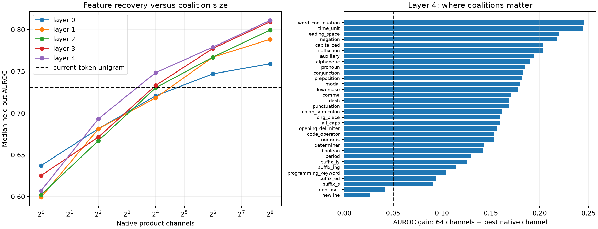

# Supervised FineWeb feature census: layers 0–4

Fifty token-level target features were declared before activation collection. Native product-channel coalitions are selected on disjoint discovery sites and evaluated on disjoint held-out sites. The competence gate uses the full model's exact clipped output logits; the unigram control asks how much is predictable from the current token alone, which is especially important because this architecture reinjects the embedding at every layer.

## Locked hypotheses

- **S0_label_coverage: not supported.**
- **S1_model_competence: supported.**
- **S2_fixed_coalitions_recover_known_features: supported.**
- **S3_coalitions_beat_single_neurons: supported.**
- **S4_depth_adds_context: supported.**
- **S5_neuron_aligned_ontology_is_sufficient: not supported.**
- **S6_embedding_reinjection_control: supported.**
- **S7_evaluation_is_held_out: supported.**
- **S8_depth_signal_survives_exact_current_token_control: supported.**

Eligible features: **32/50**. Competent features: **32/50**. Median model-output AUROC among competent labels: **0.793**; current-token unigram: **0.731**.

The exact-current-token control computes AUROC only between positive and negative sites whose current token ID is identical, then weights token groups by their number of positive-negative pairs. Chance is 0.5 even though the embedding is reintroduced at every layer.

| Feature | Positives (D/H) | Model | Unigram | L0 one / 64 | L1 one / 64 | L2 one / 64 | L3 one / 64 | L4 one / 64 | Best 90%-size |
|---|---:|---:|---:|---:|---:|---:|---:|---:|---:|
| url_web | 3/5 | 1.000 | 0.577 | 0.966/0.952 | 0.520/0.852 | 0.929/0.957 | 0.977/0.995 | 0.460/0.987 | 1 |
| percent | 8/8 | 0.999 | 0.664 | 0.934/0.994 | 0.961/0.992 | 0.708/0.992 | 0.872/0.993 | 0.956/0.977 | 1 |
| question | 27/40 | 0.991 | 0.650 | 0.487/0.699 | 0.549/0.737 | 0.542/0.740 | 0.540/0.785 | 0.619/0.755 | 64 |
| closing_delimiter | 40/36 | 0.988 | 0.706 | 0.615/0.842 | 0.651/0.795 | 0.812/0.916 | 0.544/0.855 | 0.824/0.907 | 4 |
| exclamation | 23/21 | 0.985 | 0.659 | 0.532/0.704 | 0.538/0.753 | 0.654/0.615 | 0.585/0.824 | 0.586/0.792 | 4 |
| weekday | 27/15 | 0.955 | 0.789 | 0.560/0.630 | 0.706/0.650 | 0.439/0.808 | 0.752/0.879 | 0.408/0.711 | 1 |
| word_continuation | 1837/1864 | 0.954 | 0.896 | 0.696/0.850 | 0.648/0.924 | 0.690/0.871 | 0.786/0.886 | 0.673/0.919 | 64 |
| modal | 150/169 | 0.942 | 0.707 | 0.663/0.747 | 0.710/0.723 | 0.641/0.760 | 0.713/0.779 | 0.618/0.798 | 64 |
| comma | 652/603 | 0.928 | 0.741 | 0.701/0.765 | 0.690/0.793 | 0.642/0.799 | 0.700/0.818 | 0.644/0.815 | 16 |
| colon_semicolon | 82/93 | 0.927 | 0.720 | 0.508/0.783 | 0.641/0.796 | 0.485/0.816 | 0.540/0.826 | 0.666/0.827 | 16 |
| all_caps | 163/320 | 0.920 | 0.683 | 0.603/0.774 | 0.712/0.801 | 0.680/0.787 | 0.625/0.770 | 0.635/0.795 | 16 |
| numeric | 310/436 | 0.919 | 0.726 | 0.640/0.806 | 0.634/0.835 | 0.674/0.852 | 0.675/0.850 | 0.687/0.840 | 64 |
| period | 614/630 | 0.916 | 0.749 | 0.655/0.772 | 0.676/0.788 | 0.671/0.797 | 0.711/0.804 | 0.683/0.813 | 64 |
| month | 35/58 | 0.912 | 0.655 | 0.655/0.779 | 0.641/0.695 | 0.638/0.830 | 0.709/0.793 | 0.782/0.807 | 16 |
| time_unit | 81/91 | 0.903 | 0.688 | 0.754/0.825 | 0.671/0.820 | 0.644/0.808 | 0.767/0.846 | 0.585/0.829 | 64 |
| slash | 35/32 | 0.897 | 0.716 | 0.588/0.788 | 0.664/0.768 | 0.688/0.767 | 0.458/0.862 | 0.579/0.718 | 64 |
| capitalized | 2212/2349 | 0.885 | 0.763 | 0.681/0.693 | 0.630/0.789 | 0.635/0.765 | 0.634/0.766 | 0.584/0.787 | 64 |
| suffix_ment | 57/35 | 0.884 | 0.603 | 0.600/0.661 | 0.531/0.687 | 0.564/0.648 | 0.534/0.705 | 0.490/0.701 | 4 |
| currency | 7/21 | 0.883 | 0.536 | 0.412/0.383 | 0.375/0.438 | 0.587/0.574 | 0.529/0.588 | 0.648/0.637 | 1 |
| suffix_ity | 47/43 | 0.882 | 0.612 | 0.541/0.639 | 0.484/0.666 | 0.524/0.697 | 0.508/0.704 | 0.551/0.642 | 64 |
| newline | 387/329 | 0.879 | 0.871 | 0.807/0.866 | 0.768/0.852 | 0.768/0.855 | 0.821/0.882 | 0.836/0.862 | 4 |
| opening_delimiter | 65/64 | 0.869 | 0.665 | 0.534/0.703 | 0.528/0.754 | 0.606/0.773 | 0.658/0.768 | 0.609/0.764 | 4 |
| quote | 51/41 | 0.865 | 0.632 | 0.483/0.633 | 0.537/0.553 | 0.451/0.718 | 0.589/0.712 | 0.577/0.681 | 16 |
| negation | 74/80 | 0.845 | 0.699 | 0.647/0.849 | 0.670/0.832 | 0.603/0.826 | 0.719/0.833 | 0.612/0.829 | 64 |
| suffix_ed | 415/343 | 0.843 | 0.708 | 0.589/0.712 | 0.625/0.696 | 0.644/0.719 | 0.598/0.733 | 0.643/0.737 | 16 |
| lowercase | 10986/10878 | 0.817 | 0.749 | 0.608/0.693 | 0.603/0.739 | 0.602/0.739 | 0.594/0.736 | 0.572/0.749 | 256 |
| code_operator | 244/298 | 0.814 | 0.752 | 0.634/0.786 | 0.541/0.796 | 0.508/0.820 | 0.508/0.849 | 0.604/0.757 | 64 |
| suffix_ion | 171/171 | 0.801 | 0.612 | 0.534/0.607 | 0.550/0.625 | 0.557/0.712 | 0.583/0.748 | 0.551/0.754 | 64 |
| suffix_ous | 20/11 | 0.797 | 0.514 | 0.662/0.704 | 0.587/0.748 | 0.432/0.646 | 0.418/0.659 | 0.420/0.669 | 16 |
| non_ascii | 496/353 | 0.785 | 0.832 | 0.724/0.780 | 0.720/0.771 | 0.702/0.722 | 0.730/0.783 | 0.724/0.766 | 1 |
| suffix_ive | 28/29 | 0.778 | 0.428 | 0.618/0.747 | 0.571/0.671 | 0.562/0.633 | 0.496/0.557 | 0.486/0.638 | 4 |
| quantity_unit | 55/47 | 0.770 | 0.546 | 0.522/0.603 | 0.614/0.709 | 0.588/0.633 | 0.507/0.671 | 0.618/0.670 | 256 |
| conjunction | 574/578 | 0.770 | 0.690 | 0.542/0.626 | 0.567/0.700 | 0.569/0.680 | 0.562/0.724 | 0.547/0.730 | 256 |
| suffix_ing | 375/348 | 0.769 | 0.646 | 0.598/0.608 | 0.546/0.646 | 0.515/0.641 | 0.581/0.664 | 0.548/0.662 | 16 |
| auxiliary | 737/743 | 0.768 | 0.754 | 0.626/0.732 | 0.595/0.738 | 0.639/0.748 | 0.631/0.802 | 0.616/0.810 | 64 |
| leading_space | 11742/11813 | 0.764 | 0.828 | 0.736/0.828 | 0.585/0.829 | 0.599/0.812 | 0.626/0.797 | 0.597/0.817 | 16 |
| preposition | 1589/1586 | 0.763 | 0.736 | 0.680/0.752 | 0.668/0.770 | 0.675/0.769 | 0.643/0.768 | 0.595/0.776 | 16 |
| suffix_s | 1046/1018 | 0.763 | 0.631 | 0.525/0.664 | 0.553/0.666 | 0.555/0.665 | 0.576/0.668 | 0.575/0.666 | 64 |
| pronoun | 667/727 | 0.758 | 0.748 | 0.644/0.749 | 0.564/0.764 | 0.582/0.775 | 0.601/0.776 | 0.606/0.790 | 16 |
| suffix_ness | 21/17 | 0.756 | 0.518 | 0.616/0.611 | 0.438/0.751 | 0.589/0.582 | 0.478/0.637 | 0.611/0.744 | 1 |
| alphabetic | 13200/13233 | 0.742 | 0.736 | 0.677/0.725 | 0.559/0.656 | 0.528/0.719 | 0.606/0.766 | 0.569/0.760 | 64 |
| suffix_ly | 187/158 | 0.738 | 0.583 | 0.577/0.664 | 0.578/0.691 | 0.593/0.708 | 0.564/0.710 | 0.539/0.664 | 64 |
| punctuation | 2361/2262 | 0.734 | 0.755 | 0.703/0.737 | 0.588/0.636 | 0.542/0.710 | 0.654/0.779 | 0.612/0.780 | 64 |
| dash | 207/184 | 0.728 | 0.750 | 0.620/0.747 | 0.531/0.787 | 0.530/0.788 | 0.534/0.790 | 0.622/0.790 | 64 |
| determiner | 1513/1472 | 0.706 | 0.763 | 0.692/0.752 | 0.596/0.807 | 0.665/0.801 | 0.631/0.788 | 0.634/0.778 | 64 |
| boolean | 148/148 | 0.684 | 0.633 | 0.578/0.703 | 0.603/0.709 | 0.545/0.715 | 0.601/0.727 | 0.563/0.706 | 64 |
| long_piece | 1528/1487 | 0.668 | 0.639 | 0.588/0.624 | 0.558/0.669 | 0.553/0.678 | 0.532/0.698 | 0.548/0.707 | 64 |
| programming_keyword | 341/388 | 0.654 | 0.582 | 0.612/0.654 | 0.563/0.650 | 0.568/0.676 | 0.545/0.655 | 0.569/0.673 | 64 |
| tab | 0/0 | — | — | —/— | —/— | —/— | —/— | —/— | — |
| alphanumeric | 0/0 | — | — | —/— | —/— | —/— | —/— | —/— | — |

## Exact-current-token control

| Layer | 1 channel | 4 | 16 | 64 | 256 |
|---:|---:|---:|---:|---:|---:|
| 0 | 0.518 | 0.520 | 0.535 | 0.558 | 0.572 |
| 1 | 0.511 | 0.524 | 0.562 | 0.581 | 0.596 |
| 2 | 0.539 | 0.544 | 0.557 | 0.591 | 0.623 |
| 3 | 0.528 | 0.539 | 0.567 | 0.600 | 0.637 |
| 4 | 0.547 | 0.554 | 0.597 | 0.622 | 0.650 |

## Interpretation guardrails

- These labels are supervised probes of a declared ontology, not proof that the model internally uses those exact concepts.
- A coalition is a fixed linear discriminator over native product channels. It is not yet the input-conditioned causal coalition tested by edit compilation.
- Exact-current-token AUROC removes direct token identity but not longer n-gram correlations or all lexical confounds.
- The output-logit competence score tests whether the trained model ranks the feature; it is not an exact class-probability calibration metric.
