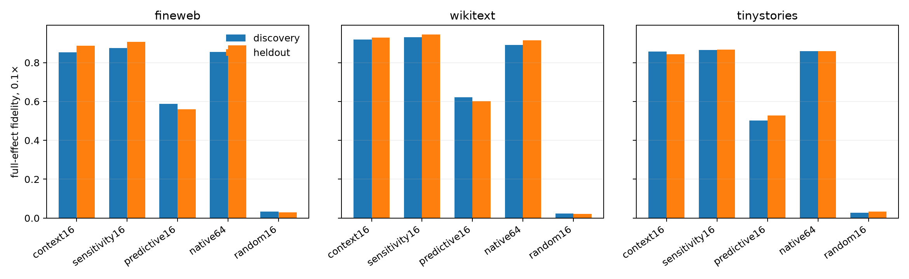

# Layer-16 causal-basis red team

All bases are discovery-frozen. Fidelity is computed on the *change* caused by the full cyclic edit, so zero means that a projected edit explains none of the target effect and one means it reproduces that effect exactly.

## Locked hypotheses

- **R0_central_difference_validates_autodiff: supported.** At least one central-difference scale has tensor-metric relative error at most 0.01.
- **R1_sensitivity16_is_mostly_context_span: supported.** Mean squared canonical overlap between metric-sensitivity-16 and the frozen context span is at least 0.75.
- **R2_context_span_is_small_edit_causally_sufficient: supported.** Context-16 tensor-effect fidelity is at least 0.75 at 0.1x on every corpus and both position groups.
- **R3_context_span_nearly_matches_sensitivity16: supported.** Metric-sensitivity-16 exceeds context-16 by at most 0.10 at 0.1x on every corpus and both position groups.
- **R4_native64_is_not_a_substitute_for_dense_sensitivity16: not supported.** Metric-sensitivity-16 exceeds top-native-64 by at least 0.20 at 0.1x on every corpus at held-out positions.
- **R5_sensitivity16_beats_random_dense16: supported.** Metric-sensitivity-16 exceeds random-dense-16 by at least 0.50 at 0.1x on every corpus and both position groups.
- **R6_sensitivity16_beats_predictive16: supported.** Metric-sensitivity-16 exceeds predictive-16 by at least 0.20 at 0.1x on every corpus and both position groups.
- **R7_sensitivity16_transfers_to_unseen_positions: supported.** For each corpus, metric-sensitivity-16 differs by at most 0.15 between discovery and held-out positions at 0.1x.
- **R8_sensitivity16_remains_full_edit_sufficient: supported.** Metric-sensitivity-16 tensor-effect fidelity is at least 0.85 at 1.0x on every corpus and both position groups.
- **R9_each_metric_finds_a_compact_causal_basis: supported.** Metric-sensitivity-16 reaches 0.75 in tensor fidelity and Euclidean-sensitivity-16 reaches 0.75 in coefficient fidelity at 0.1x everywhere.
- **R10_metric_choice_does_not_radically_rotate_the_basis: supported.** Mean squared canonical overlap between metric- and Euclidean-sensitivity-16 is at least 0.50.
- **R11_native128_remains_incomplete: not supported.** Top-native-128 tensor-effect fidelity is below 0.70 at 0.1x on every corpus at held-out positions.

## Numerical and geometric diagnostics

Central finite-difference relative errors: `{'0.01': 0.00011283412219290583, '0.003': 0.0003185306609409574, '0.001': 0.0010764651541972212, '0.0003': 0.003538446669897562, '0.0001': 0.009920016795064211}`.
Metric16–context16 mean squared canonical overlap: `0.830`.
Metric16–Euclidean16 overlap: `0.838`.
Metric sensitivity R90/R99: `7` / `59`.
Top native coordinate energy shares at 16/64/128: `0.250` / `0.373` / `0.481`.

## Tensor-effect fidelity at 0.1×

| Corpus | Positions | context16 | sensitivity16 | Euclidean16 | predictive16 | native16/64/128 | random dense16 |
|---|---|---:|---:|---:|---:|---:|---:|
| fineweb | discovery | 0.852 | 0.875 | 0.850 | 0.587 | 0.826/0.855/0.880 | 0.033 |
| fineweb | heldout | 0.886 | 0.906 | 0.885 | 0.560 | 0.862/0.888/0.910 | 0.029 |
| wikitext | discovery | 0.919 | 0.931 | 0.920 | 0.623 | 0.852/0.891/0.919 | 0.024 |
| wikitext | heldout | 0.928 | 0.944 | 0.931 | 0.601 | 0.891/0.915/0.936 | 0.022 |
| tinystories | discovery | 0.857 | 0.864 | 0.865 | 0.502 | 0.825/0.859/0.885 | 0.028 |
| tinystories | heldout | 0.844 | 0.868 | 0.863 | 0.528 | 0.828/0.859/0.885 | 0.033 |

## Interpretation boundary

The sensitivity basis mostly recovers the predefined context span, so its success is primarily an architectural validation rather than discovery of a new hidden code. The locked dense-only alternatives also fail: top sensitivity-ranked residual coordinates are unexpectedly competitive with the dense basis. These coordinates are residual dimensions, not bilinear MLP neurons, and their semantic meaning and split stability remain unproved.

The result establishes causal sufficiency only for this Layer-16-to-Layer-17 operator effect. It does not establish semantic meaning, on-manifold editability, or downstream-logit sufficiency. Metric dependence remains a general concern even though the coefficient and tensor metrics select substantially overlapping bases here.
