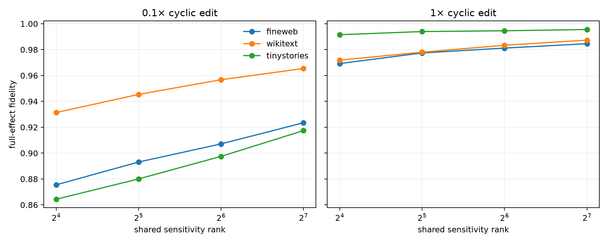

# Exact Layer-16 Jacobian causal subspaces

The output metric is induced by the contracted context-to-operator tensor. Shared sensitivity bases come from the SVD of discovery `G^(1/2)J` rows; every finite patch is executed through native final attention and RMS normalization.

## Locked hypotheses

- **J0_autodiff_jacobian_matches_finite_difference: not supported.** The tensor-metric relative error of the local Jacobian finite-difference control is at most 0.01.
- **J1_small_edit_linearization_is_accurate: supported.** The exact local Jacobian predicts 0.1x cyclic-edit effects with at least 0.90 fidelity on every corpus.
- **J2_full_edit_is_more_nonlinear: supported.** Full-edit Jacobian fidelity is at least 0.10 below small-edit fidelity on every corpus.
- **J3_site_specific_rowspace_captures_small_effect: supported.** Projecting 0.1x edits into the site-specific Jacobian row space reproduces at least 0.90 of the full finite effect on every corpus.
- **J4_site_specific_rowspace_remains_useful_for_full_edits: not supported.** The site-specific Jacobian row space reproduces at least 0.70 of the full cyclic-edit effect on every corpus.
- **J5_shared_sensitivity64_captures_small_effect: supported.** The discovery-frozen rank-64 aggregate sensitivity subspace reproduces at least 0.70 of the 0.1x edit effect on every corpus.
- **J6_sensitivity64_beats_random64: supported.** At 0.1x scale, sensitivity rank 64 exceeds matched random rank 64 by at least 0.30 on every corpus.
- **J7_sensitivity16_beats_predictive16: supported.** At 0.1x scale, aggregate sensitivity rank 16 exceeds the predictive ridge span by at least 0.20 on every corpus.
- **J8_sensitivity128_is_useful_for_full_edits: supported.** Aggregate sensitivity rank 128 reproduces at least 0.50 of full cyclic-edit effects on every corpus.
- **J9_shared_sensitivity_subspace_transfers_ood: supported.** Sensitivity-rank-64 small-edit fidelity differs by at most 0.15 across corpora.
- **J10_tensor_metric_is_positive: supported.** The context-to-operator Gram matrix is positive semidefinite to numerical tolerance.

Finite-difference relative error: `2.015e-02`. Sensitivity R90/R99: `7` / `59`.

## Full-effect fidelity

| Corpus | Scale | linear J | predictive16 | site-specific | sensitivity 16/32/64/128 | random 16/64 |
|---|---:|---:|---:|---:|---:|---:|
| fineweb | 0.1 | 0.991 | 0.587 | 0.992 | 0.875/0.893/0.907/0.923 | 0.021/0.059 |
| fineweb | 1 | 0.160 | 0.649 | 0.535 | 0.969/0.977/0.981/0.985 | 0.020/0.060 |
| wikitext | 0.1 | 0.953 | 0.623 | 0.958 | 0.931/0.945/0.957/0.965 | 0.025/0.083 |
| wikitext | 1 | 0.138 | 0.663 | 0.621 | 0.972/0.978/0.983/0.987 | 0.024/0.080 |
| tinystories | 0.1 | 0.995 | 0.502 | 0.997 | 0.864/0.880/0.897/0.917 | 0.026/0.075 |
| tinystories | 1 | 0.479 | 0.560 | 0.676 | 0.992/0.994/0.995/0.996 | 0.024/0.063 |

## Interpretation boundary

The exact Jacobian describes one local tangent map. Its site-specific row space is an oracle causal coordinate for infinitesimal edits, while a discovery-aggregated sensitivity space tests reusable geometry. Degradation at full edit scale measures curvature and context change; it does not invalidate the derivative. The failed predictive span remains a valid decoder even when it is a poor intervention basis.
