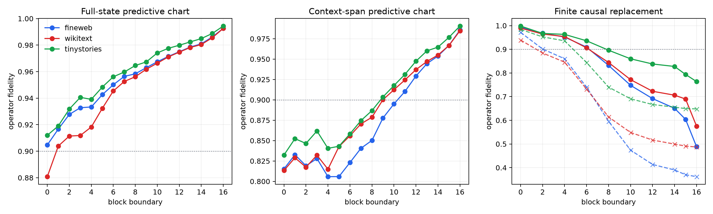

# Causal compilation depth of the Layer-17 operator router

Predictive charts and finite causal cuts are measured separately. The causal intervention replaces one current-position carried state, preserves the original embedding and persistent value bus, and exactly recomputes the remaining tensor-network suffix.

## Locked hypotheses

- **D0_native_suffix_recomposition_is_exact: supported.** Independent native prefix and boundary-suffix execution agree in context coefficients to relative error at most 1e-6.
- **D1_final_carried_state_predicts_operator: supported.** A discovery-frozen linear map from Layer-16 current-position state reaches at least 0.95 operator fidelity on every corpus.
- **D2_final_state_improves_on_embedding_chart: supported.** The Layer-16 state predictor exceeds the native-token-embedding predictor by at least 0.05 on every corpus.
- **D3_final_predictor_beats_matched_response_null: supported.** The Layer-16 predictor exceeds the p95 of 16 coarse-class-and-position-matched response permutations by at least 0.10 on every corpus.
- **D4_early_state_is_causally_recoverable: supported.** Mean replacement after Block 0 retains at least 0.90 operator fidelity on every corpus.
- **D5_final_state_is_causally_necessary: supported.** Mean replacement after Block 16 retains at most 0.80 operator fidelity on every corpus.
- **D6_causal_dependence_grows_with_depth: supported.** Mean-replacement fidelity drops by at least 0.15 from Block 0 to Block 16 on every corpus.
- **D7_cyclic_final_state_is_material: supported.** Cyclic Layer-16 state substitution retains at most 0.80 operator fidelity on every corpus.
- **D8_decodability_precedes_causal_commitment: supported.** Every corpus has at least one tested boundary whose predictor reaches 0.80 while mean replacement still retains 0.90.
- **D9_compilation_boundary_transfers: supported.** The first tested boundary below 0.90 mean-replacement fidelity differs by at most four layers across corpora.
- **D10_context_span_chart_is_useful_at_the_end: supported.** A predictor using only Layer-16 projections onto the tensor context span reaches at least 0.80 fidelity on every corpus.

## Predictive fidelity by block boundary

| Layer | fineweb full/context | wikitext full/context | tinystories full/context |
|---:|---:|---:|---:|
| 0 | 0.905/0.815 | 0.881/0.813 | 0.912/0.832 |
| 1 | 0.917/0.833 | 0.904/0.829 | 0.919/0.852 |
| 2 | 0.928/0.819 | 0.911/0.817 | 0.932/0.846 |
| 3 | 0.933/0.828 | 0.912/0.832 | 0.941/0.862 |
| 4 | 0.933/0.806 | 0.918/0.815 | 0.939/0.840 |
| 5 | 0.943/0.806 | 0.932/0.843 | 0.948/0.843 |
| 6 | 0.950/0.823 | 0.945/0.856 | 0.956/0.858 |
| 7 | 0.956/0.841 | 0.953/0.871 | 0.960/0.875 |
| 8 | 0.958/0.850 | 0.956/0.879 | 0.965/0.887 |
| 9 | 0.963/0.878 | 0.962/0.900 | 0.967/0.904 |
| 10 | 0.967/0.895 | 0.966/0.912 | 0.974/0.918 |
| 11 | 0.971/0.910 | 0.971/0.924 | 0.978/0.931 |
| 12 | 0.975/0.929 | 0.975/0.937 | 0.980/0.947 |
| 13 | 0.979/0.944 | 0.978/0.947 | 0.982/0.960 |
| 14 | 0.981/0.954 | 0.980/0.955 | 0.985/0.965 |
| 15 | 0.986/0.967 | 0.986/0.967 | 0.989/0.977 |
| 16 | 0.993/0.986 | 0.993/0.985 | 0.994/0.991 |

Native-embedding baseline: fineweb `0.884`, wikitext `0.852`, tinystories `0.896`.

## Finite causal fidelity

| Layer | fineweb mean/cycle | wikitext mean/cycle | tinystories mean/cycle |
|---:|---:|---:|---:|
| 0 | 0.994/0.971 | 0.990/0.939 | 0.998/0.984 |
| 2 | 0.968/0.901 | 0.964/0.884 | 0.967/0.952 |
| 4 | 0.952/0.860 | 0.954/0.846 | 0.963/0.936 |
| 6 | 0.909/0.740 | 0.906/0.732 | 0.936/0.844 |
| 8 | 0.832/0.596 | 0.844/0.614 | 0.896/0.740 |
| 10 | 0.748/0.474 | 0.772/0.549 | 0.860/0.691 |
| 12 | 0.692/0.414 | 0.723/0.517 | 0.838/0.667 |
| 14 | 0.651/0.390 | 0.706/0.500 | 0.827/0.655 |
| 15 | 0.604/0.370 | 0.690/0.491 | 0.794/0.649 |
| 16 | 0.489/0.362 | 0.575/0.487 | 0.764/0.648 |

First tested mean-replacement boundary below 0.90: fineweb Block 8, wikitext Block 8, tinystories Block 8.

## Interpretation boundary

A predictive chart can become accurate before its state is causally indispensable because later blocks retain the original embedding and can reconstruct the router. The finite cut measures recoverability under one intervention, not exclusive information storage. A gradual curve should not be renamed a discrete phase transition merely because a 0.90 reporting threshold is crossed.
