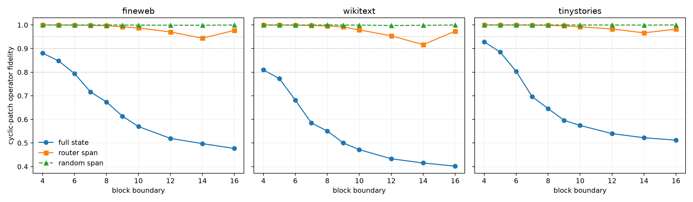

# Causal router-subspace and threshold red team

The predictive ridge map defines a 16-dimensional input span at each layer. Mean and cyclic edits are restricted to that span, to a matched random span, or to the full state before exact suffix recomputation.

## Locked hypotheses

- **S0_native_suffix_recomposition_is_exact: supported.** Independent native prefix and suffix execution agree to relative context-coordinate error at most 1e-6.
- **S1_full_state_trace_replicates: not supported.** Overlapping full-state mean and cyclic fidelities differ from the parent trace by at most 0.10 on every corpus and boundary.
- **S2_router_subspace_is_causally_relevant_at_layer16: not supported.** At Layer 16, cyclic replacement in the fitted router input span produces at least half the operator-fidelity loss of full-state cyclic replacement on every corpus.
- **S3_router_subspace_beats_random_at_layer16: not supported.** At Layer 16, cyclic router-subspace replacement is at least 0.10 more damaging than matched random-subspace replacement on every corpus.
- **S4_early_predictive_span_is_recoverable: supported.** At Layer 4, cyclic router-subspace replacement retains at least 0.90 operator fidelity on every corpus.
- **S5_compilation_curve_is_gradual: supported.** Across consecutive Blocks 4 through 10, the largest one-layer drop in full-state mean-replacement fidelity is at most 0.12 on every corpus.
- **S6_single_boundary_is_threshold_dependent: supported.** For every corpus, the first crossings of 0.95, 0.90, and 0.80 full-state mean-replacement fidelity are not all the same tested boundary.
- **S7_strict_commitment_depth_is_corpus_dependent: not supported.** The first 0.80 crossing differs by at least four layers across corpora.
- **S8_router_span_fraction_grows_with_depth: supported.** The fraction of full cyclic loss explained by the router subspace is larger at Layer 16 than Layer 4 on every corpus.
- **S9_random_subspace_is_not_equally_causal: supported.** Averaged across all tested layers, router-subspace cyclic loss exceeds random-subspace cyclic loss on every corpus.

## Cyclic-substitution fidelity

| Layer | fineweb full/router/random | wikitext full/router/random | tinystories full/router/random |
|---:|---:|---:|---:|
| 4 | 0.881/1.000/1.000 | 0.809/1.000/1.000 | 0.929/1.000/1.000 |
| 5 | 0.848/1.000/1.000 | 0.773/1.000/1.000 | 0.885/1.000/1.000 |
| 6 | 0.794/1.000/1.000 | 0.681/0.999/1.000 | 0.803/1.000/1.000 |
| 7 | 0.716/0.998/1.000 | 0.585/0.998/1.000 | 0.697/0.999/1.000 |
| 8 | 0.674/0.997/1.000 | 0.551/0.996/1.000 | 0.646/0.998/1.000 |
| 9 | 0.613/0.992/1.000 | 0.500/0.992/1.000 | 0.596/0.996/1.000 |
| 10 | 0.570/0.987/0.999 | 0.472/0.979/0.999 | 0.574/0.992/1.000 |
| 12 | 0.519/0.970/0.999 | 0.433/0.954/0.998 | 0.540/0.983/1.000 |
| 14 | 0.497/0.944/0.999 | 0.415/0.917/0.999 | 0.522/0.967/0.999 |
| 16 | 0.477/0.977/1.000 | 0.402/0.974/1.000 | 0.512/0.982/1.000 |

## Mean-replacement threshold crossings

| Corpus | first below 0.95 | first below 0.90 | first below 0.80 | parent max difference |
|---|---:|---:|---:|---:|
| fineweb | 4 | 7 | 10 | 0.115 |
| wikitext | 4 | 6 | 9 | 0.109 |
| tinystories | 6 | 8 | 12 | 0.136 |

## Interpretation boundary

A causal predictive span is a useful intervention coordinate, not necessarily a unique feature basis. Full-state replacement tests recoverability of an entire carrier; router-span replacement tests the supervised directions used by one linear chart. Threshold crossings summarize a smooth curve and should not be promoted to a universal anatomical boundary.
