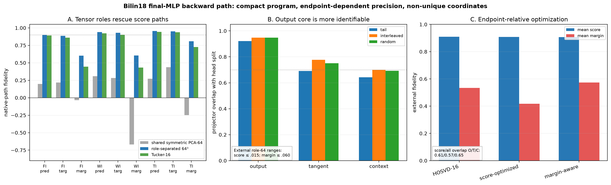

# Behavior-optimized rank-16 cores of the tangent-bundle tensor

Two endpoint definitions are optimized inside the same fixed rank-64 role tensor: individual prediction/target scores, and those scores plus their precision-sensitive difference. Training uses 192 discovery sites; checkpoint selection uses the remaining 64; external corpora are untouched evaluation.

## Locked hypotheses

- **O0_hosvd_baseline_matches_prior_result: supported.** The recomputed Euclidean HOSVD-16 baseline is within 0.01 of the prior head-split external fidelities.
- **O1_score_objective_improves_scores: not supported.** Every score-optimized seed improves mean external prediction/target fidelity over HOSVD-16 by at least 0.02.
- **O2_all_objective_improves_margin: not supported.** Every all-endpoint seed improves mean external margin fidelity over HOSVD-16 by at least 0.08.
- **O3_margin_gain_does_not_destroy_scores: supported.** Every all-endpoint seed retains at least 0.80 prediction and target fidelity on every external corpus.
- **O4_validation_selection_transfers: supported.** For both objectives, the seed with best validation objective is no worse than 0.03 below the best seed on the corresponding mean external objective.
- **O5_behavior_cores_are_seed_stable: supported.** Within each objective, the external objective range across seeds is at most 0.05.
- **O6_score_and_margin_cores_are_distinct: supported.** The best-validation score and all-endpoint cores have projector overlap below 0.90 in at least one tensor role.
- **O7_optimized_core_is_a_heldout_claim: supported.** Optimization uses only the first 192 discovery sites; the final 64 sites select checkpoints and all external corpora remain untouched until evaluation.

HOSVD mean external score fidelity: `0.909`; margin: `0.534`.

## External objective summary

| Objective | seed | selected step | validation loss | mean external score | mean external margin |
|---|---:|---:|---:|---:|---:|
| scores | 0 | 10 | 0.1240 | 0.900 | 0.432 |
| scores | 1 | 50 | 0.1195 | 0.907 | 0.418 |
| scores | 2 | 40 | 0.1276 | 0.905 | 0.421 |
| all | 0 | 40 | 0.3709 | 0.907 | 0.573 |
| all | 1 | 110 | 0.3710 | 0.902 | 0.575 |
| all | 2 | 30 | 0.3744 | 0.904 | 0.573 |

## Selected-core external fidelity

Each cell is prediction/target/margin.

| Objective | corpus | HOSVD-16 | optimized-16 |
|---|---|---:|---:|
| scores | fineweb | 0.891/0.860/0.445 | 0.877/0.858/0.399 |
| scores | wikitext | 0.921/0.901/0.433 | 0.915/0.892/0.361 |
| scores | tinystories | 0.942/0.938/0.726 | 0.961/0.941/0.493 |
| all | fineweb | 0.891/0.860/0.445 | 0.863/0.832/0.508 |
| all | wikitext | 0.921/0.901/0.433 | 0.927/0.909/0.508 |
| all | tinystories | 0.942/0.938/0.726 | 0.959/0.950/0.703 |

Selected score/all core projector overlap (output/tangent/context): 0.615/0.566/0.651.

Exploratory within-objective pairwise overlap ranges (output/tangent/context):
- scores: 0.707–0.756/0.665–0.691/0.672–0.743
- all: 0.670–0.760/0.591–0.714/0.632–0.741

If endpoint-specific optimization yields different transferable cores, compactness is real but the shortest useful program depends on whether the use case is score explanation, decision certification, or exact distribution emulation.
