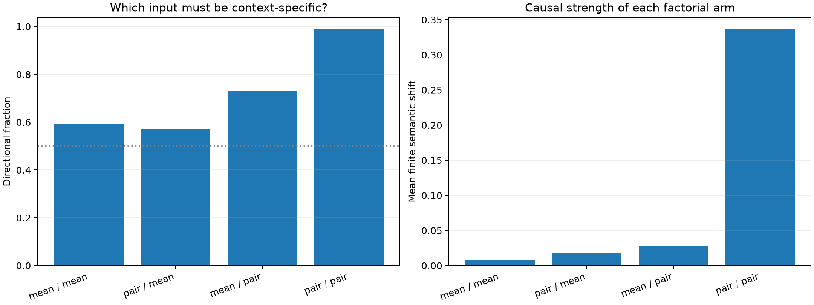

# Layer-1 semantic coalition factorial

The successful pair-local selector combines two state-dependent objects: the donor-minus-recipient product delta and the recipient suffix gradient for the declared semantic score. This 2×2 test replaces either object with its disjoint-discovery feature mean, freezes the resulting rank-64 support before finite intervention, and evaluates the same 96 held-out patches.

## Locked hypotheses

- **F0_pair_delta_is_sufficient: not supported.**
- **F1_pair_gradient_is_sufficient: not supported.**
- **F2_joint_conditioning_is_necessary: supported.**
- **F3_activation_delta_is_dominant_router_input: not supported.**
- **F4_local_linearization_survives: not supported.**
- **F5_no_evaluation_outcomes_select_support: supported.**

| Delta / gradient | Directional all / uniform | Mean shift | First-order sign / corr. |
|---|---:|---:|---:|
| mean / mean | 0.594 / 0.542 | +0.0075 | 0.667 / 0.556 |
| pair / mean | 0.573 / 0.583 | +0.0184 | 0.812 / 0.812 |
| mean / pair | 0.729 / 0.604 | +0.0285 | 0.854 / 0.915 |
| pair / pair | 0.990 / 0.979 | +0.3369 | 0.990 / 0.922 |

## Interpretation

The factorial distinguishes a router that merely predicts which channels changed from one that must also evaluate how the remaining network will use each change. Joint superiority supports the full input-conditioned-coalition account; success of one singly conditioned arm identifies a simpler prospective target.
