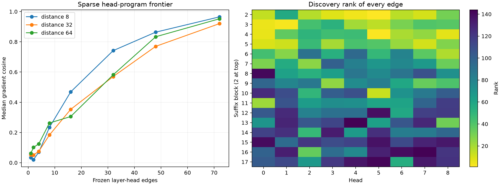

# Discovery-frozen layer-head sparsity for cross-position programs

Eight disjoint FineWeb rows at distance 32 rank the 72 suffix layer-head edges by leave-one-out loss of contribution cosine. The frozen ordering is evaluated on new rows at distances 8, 32, and 64, alongside matched random edge sets. Every selected head program is composed through native residual and MLP VJPs.

Maximum local head recomposition error: `1.04e-06`.

## Locked hypotheses

- **Y0_head_vjps_recompose_native_attention: not supported.**
- **Y1_frozen_top16_is_high_fidelity: not supported.**
- **Y2_frozen_top16_beats_random: supported.**
- **Y3_frozen_top32_is_very_high_fidelity: not supported.**
- **Y4_important_edges_are_early_concentrated: supported.**
- **Y5_frozen_top16_is_causally_directional: supported.**
- **Y6_selection_is_discovery_only: supported.**

## Frozen top edges

| Rank | Block | Head | Discovery leave-one-out score |
|---:|---:|---:|---:|
| 1 | 2 | 5 | 0.04481 |
| 2 | 4 | 5 | 0.03394 |
| 3 | 3 | 1 | 0.03378 |
| 4 | 2 | 4 | 0.03202 |
| 5 | 3 | 0 | 0.02845 |
| 6 | 4 | 0 | 0.02834 |
| 7 | 4 | 8 | 0.02725 |
| 8 | 2 | 3 | 0.02527 |
| 9 | 5 | 0 | 0.02472 |
| 10 | 2 | 7 | 0.02340 |
| 11 | 5 | 7 | 0.02309 |
| 12 | 5 | 1 | 0.02261 |
| 13 | 10 | 5 | 0.02189 |
| 14 | 2 | 0 | 0.02089 |
| 15 | 3 | 5 | 0.01802 |
| 16 | 2 | 6 | 0.01757 |

## Distance 8

| Edge budget | Gradient cosine | Contribution cosine | Finite direction | Random p95 |
|---:|---:|---:|---:|---:|
| 1 | 0.034 | 0.052 | 0.818 | — |
| 2 | 0.020 | -0.003 | 0.636 | — |
| 4 | 0.070 | 0.048 | 0.727 | 0.147 |
| 8 | 0.234 | 0.285 | 0.909 | 0.156 |
| 16 | 0.468 | 0.521 | 1.000 | 0.239 |
| 32 | 0.742 | 0.701 | 1.000 | 0.514 |
| 48 | 0.864 | 0.861 | 1.000 | — |
| 72 | 0.965 | 0.963 | 1.000 | — |

## Distance 32

| Edge budget | Gradient cosine | Contribution cosine | Finite direction | Random p95 |
|---:|---:|---:|---:|---:|
| 1 | 0.052 | 0.001 | 0.417 | — |
| 2 | 0.051 | 0.036 | 0.667 | — |
| 4 | 0.075 | 0.144 | 0.500 | 0.169 |
| 8 | 0.183 | 0.260 | 0.750 | 0.120 |
| 16 | 0.353 | 0.378 | 0.917 | 0.194 |
| 32 | 0.570 | 0.589 | 1.000 | 0.278 |
| 48 | 0.770 | 0.744 | 1.000 | — |
| 72 | 0.920 | 0.939 | 1.000 | — |

## Distance 64

| Edge budget | Gradient cosine | Contribution cosine | Finite direction | Random p95 |
|---:|---:|---:|---:|---:|
| 1 | 0.063 | 0.099 | 0.583 | — |
| 2 | 0.101 | 0.115 | 0.667 | — |
| 4 | 0.125 | 0.083 | 0.750 | 0.143 |
| 8 | 0.263 | 0.253 | 0.750 | 0.127 |
| 16 | 0.305 | 0.304 | 1.000 | 0.180 |
| 32 | 0.582 | 0.569 | 1.000 | 0.244 |
| 48 | 0.833 | 0.827 | 1.000 | — |
| 72 | 0.952 | 0.957 | 1.000 | — |

## Guardrail

Leave-one-out ranking is a discovery-frozen heuristic, not a proof of unique head importance. Correlated or synergistic heads can make individual omissions look small, and a compact selected program remains state-conditioned across positions and MLP operators.
