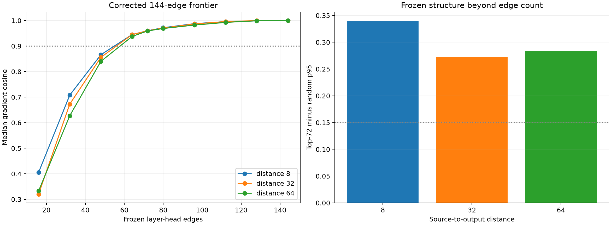

# Corrected 144-edge head-sparsity replication

The earlier assay incorrectly treated 72 edges as the complete 16-block × 9-head suffix. This correction preserves its discovery-frozen ordering, evaluates all 144 edges for the exactness gate, and uses entirely new FineWeb rows for the compactness frontier.

Maximum local head recomposition error: `9.72e-07`.

## Locked hypotheses

- **Z0_all_144_edges_are_exact: supported.**
- **Z1_frozen_top72_replication: supported.**
- **Z2_frozen_top48_is_useful: supported.**
- **Z3_top32_remains_insufficient: supported.**
- **Z4_top72_beats_random: supported.**
- **Z5_half_the_edges_are_sufficient: supported.**
- **Z6_top72_is_causally_directional: supported.**
- **Z7_ordering_is_frozen: supported.**

| Distance | First rank at cosine 0.90 | Top-32 | Top-48 | Top-72 | Top-144 | Random-72 p95 | Top-72 finite direction |
|---:|---:|---:|---:|---:|---:|---:|---:|
| 8 | 64 | 0.708 | 0.866 | 0.960 | 1.000 | 0.620 | 1.000 |
| 32 | 64 | 0.673 | 0.856 | 0.960 | 1.000 | 0.687 | 1.000 |
| 64 | 64 | 0.627 | 0.840 | 0.959 | 1.000 | 0.676 | 1.000 |

## Guardrail

A 72-edge program is half of the available layer-head graph, not a tiny sparse circuit. Its strong advantage over random establishes structured concentration, while its size argues that native heads are still too coarse to be the final explanatory units.
