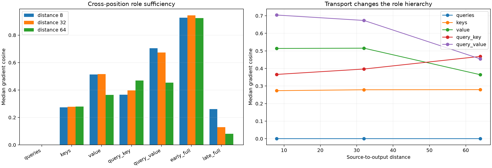

# Cross-position red team of suffix role programs

A natural FineWeb token at an earlier position is replaced by newline, while behavior is scored at Position 127 along the full model's own probability-change direction. The exact Layer-1 product gradient at the edit position is decomposed through query, key, and value VJPs. This changes the causal geometry: some key or value derivative must transport sensitivity backward to the edited position.

Maximum local role recomposition error: `8.14e-08`.

## Locked hypotheses

- **X0_role_program_is_exact: supported.**
- **X1_nontransport_programs_are_structurally_zero: supported.**
- **X2_key_or_value_transport_is_material: not supported.**
- **X3_queries_refine_transported_signals: supported.**
- **X4_no_single_transport_family_is_universally_sufficient: supported.**
- **X5_early_eight_blocks_are_not_always_sufficient: not supported.**
- **X6_exact_coalitions_have_finite_direction: supported.**

### Distance 8

| Program | Gradient cosine | Norm / exact | Contribution cosine | Finite direction |
|---|---:|---:|---:|---:|
| mlp_only | 0.000 | 0.000e+00 | 0.000 | 0.625 |
| queries | 0.000 | 0.000e+00 | 0.000 | 0.625 |
| keys | 0.274 | 2.007e-01 | 0.290 | 0.812 |
| value | 0.514 | 5.343e-01 | 0.450 | 1.000 |
| query_key | 0.366 | 3.180e-01 | 0.399 | 0.875 |
| query_value | 0.704 | 7.034e-01 | 0.725 | 1.000 |
| key_value | 0.812 | 7.875e-01 | 0.807 | 1.000 |
| early_full | 0.927 | 6.933e-01 | 0.929 | 1.000 |
| late_full | 0.260 | 9.435e-02 | 0.239 | 0.875 |
| all_full | 1.000 | 1.000e+00 | 1.000 | 1.000 |

### Distance 32

| Program | Gradient cosine | Norm / exact | Contribution cosine | Finite direction |
|---|---:|---:|---:|---:|
| mlp_only | 0.000 | 0.000e+00 | 0.000 | 0.333 |
| queries | 0.000 | 0.000e+00 | 0.000 | 0.333 |
| keys | 0.279 | 2.357e-01 | 0.280 | 0.867 |
| value | 0.515 | 5.392e-01 | 0.548 | 1.000 |
| query_key | 0.397 | 2.833e-01 | 0.419 | 0.933 |
| query_value | 0.673 | 6.546e-01 | 0.658 | 1.000 |
| key_value | 0.760 | 8.400e-01 | 0.781 | 1.000 |
| early_full | 0.944 | 7.395e-01 | 0.947 | 1.000 |
| late_full | 0.130 | 7.127e-02 | 0.138 | 0.733 |
| all_full | 1.000 | 1.000e+00 | 1.000 | 1.000 |

### Distance 64

| Program | Gradient cosine | Norm / exact | Contribution cosine | Finite direction |
|---|---:|---:|---:|---:|
| mlp_only | 0.000 | 0.000e+00 | 0.000 | 0.667 |
| queries | 0.000 | 0.000e+00 | 0.000 | 0.667 |
| keys | 0.279 | 2.563e-01 | 0.315 | 0.867 |
| value | 0.364 | 3.841e-01 | 0.357 | 1.000 |
| query_key | 0.469 | 3.588e-01 | 0.494 | 1.000 |
| query_value | 0.454 | 4.748e-01 | 0.457 | 1.000 |
| key_value | 0.759 | 9.043e-01 | 0.772 | 1.000 |
| early_full | 0.924 | 7.316e-01 | 0.923 | 1.000 |
| late_full | 0.081 | 5.232e-02 | 0.064 | 0.667 |
| all_full | 1.000 | 1.000e+00 | 1.000 | 1.000 |

## Guardrail

The output direction is defined from each example's full token-substitution effect, so this assay explains a known behavioral change rather than prospectively predicting which change will occur. Its purpose is to distinguish structural transport roles, not to claim a reusable semantic feature.
