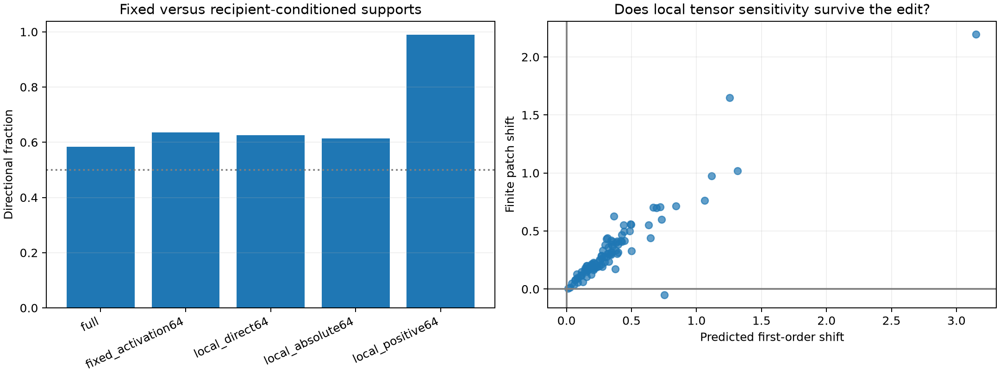

# Dynamic semantic coalitions at layer 1

For each held-out same-token donor–recipient pair, the exact recipient-state derivative of the final semantic class score with respect to all 4,608 layer-1 product channels is combined with the donor activation delta. Two rank-64 supports are then validated by finite patching: largest absolute first-order contributions (approximate the full path) and largest positive contributions (move toward the donor label). This reads the endpoint activation delta and is therefore a mechanistic upper bound, not a prospective semantic decoder.

## Locked hypotheses

- **D0_local_positive_coalition_is_directional: supported.**
- **D1_local_positive_generalizes_across_pair_selection: supported.**
- **D2_local_absolute_support_tracks_full_path: not supported.**
- **D3_dynamic_support_beats_fixed_semantic_support: supported.**
- **D4_first_order_sign_survives_finite_patch: supported.**
- **D5_dynamic_selector_is_an_upper_bound: supported.**

| Method | Directional all / uniform | Mean shift | Mean abs | Corr. with full |
|---|---:|---:|---:|---:|
| full | 0.583 / 0.562 | +0.1467 | 0.3889 | 1.000 |
| fixed_activation64 | 0.635 / 0.583 | +0.0114 | 0.0315 | 0.218 |
| local_direct64 | 0.625 / 0.604 | +0.0143 | 0.0622 | 0.358 |
| local_absolute64 | 0.615 / 0.562 | +0.0183 | 0.1105 | 0.280 |
| local_positive64 | 0.990 / 0.979 | +0.3369 | 0.3379 | 0.127 |

First-order versus finite local-positive patches: sign agreement **99.0%**, correlation **0.922**.

## Interpretation

Success establishes that a small recipient-conditioned native-channel coalition can be computed and causally validated. It does not make the feature neuron-aligned: the selected support may change almost completely across contexts. Failure would mean either that 64 channels are insufficient or that a first-order channel decomposition is not stable for these donor-sized finite moves.
